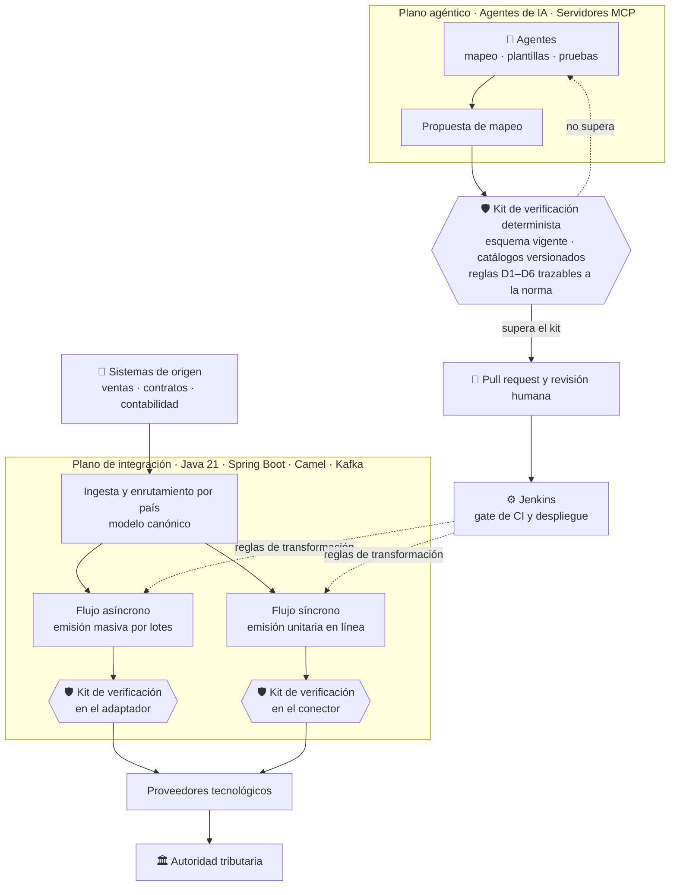
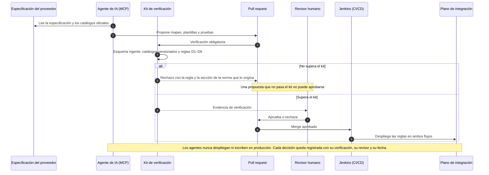
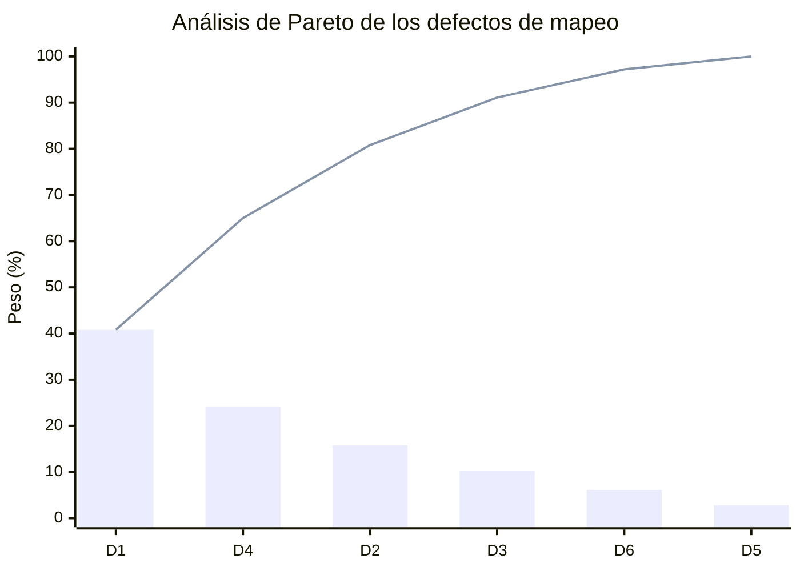
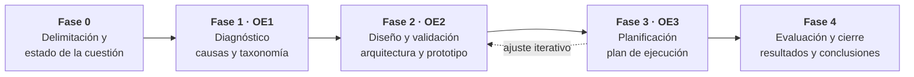

# 🧾 Veriagent eInvoice LATAM

### *Planificación de una arquitectura agéntica verificable para facturación electrónica multipaís en Latinoamérica*

**Trabajo de Fin de Grado · Ingeniería Informática · Fundación Universitaria Internacional de La Rioja (UNIR)**

**[Contexto](#-contexto-y-alcance) • [Objetivos](#-objetivos) • [Entregas](#-entregas) • [Arquitectura](#️-arquitectura) • [Taxonomía](#-taxonomía-de-defectos-d1d6) • [Metodología](#-metodología) • [Autor](#-autor)**

---

## 📋 Tabla de Contenidos

- [🎯 Contexto y Alcance](#-contexto-y-alcance)
- [❓ Pregunta de Investigación](#-pregunta-de-investigación)
- [🏁 Objetivos](#-objetivos)
- [📁 Contenido del Repositorio](#-contenido-del-repositorio)
- [📦 Entregas](#-entregas)
- [🏗️ Arquitectura](#️-arquitectura)
- [🔁 Ciclo Gobernado de una Propuesta](#-ciclo-gobernado-de-una-propuesta)
- [🧬 Taxonomía de Defectos D1–D6](#-taxonomía-de-defectos-d1d6)
- [🔬 Metodología](#-metodología)
- [📏 Métricas de Evaluación (GQM)](#-métricas-de-evaluación-gqm)
- [🧭 Trazabilidad Objetivos → Entregables](#-trazabilidad-objetivos--entregables)
- [🧰 Tecnologías, Estándares y Marcos](#-tecnologías-estándares-y-marcos)
- [📖 Consulta de los Documentos](#-consulta-de-los-documentos)
- [🔐 Confidencialidad y Alcance](#-confidencialidad-y-alcance)
- [📚 Referencias Clave](#-referencias-clave)
- [👤 Autor](#-autor)

---

## 🎯 Contexto y Alcance

La factura electrónica con **validación previa** es hoy la base de la fiscalización digital en Latinoamérica: más de quince países de la región la exigen, y el comprobante solo tiene efectos fiscales después de que la autoridad tributaria, o un proveedor autorizado, lo valida. Cada país define **su propio formato, sus catálogos de códigos y sus reglas**, y los cambia por versiones; a diferencia de Europa con la norma EN 16931, la región no tiene un modelo semántico común.

Para una organización multinacional, esto significa que **cada país o proveedor tecnológico nuevo obliga a construir de nuevo el mapeo** entre su modelo de datos canónico y el formato nacional (JSON, texto por segmentos o XML basado en UBL 2.1): una tarea manual de aproximadamente **cien campos** que produce defectos recurrentes y que solo se detectan cuando el proveedor o la autoridad tributaria **rechazan el documento**.

Este trabajo planifica una arquitectura en la que **agentes de inteligencia artificial** proponen los mapeos, plantillas y pruebas que exige cada país y proveedor, mientras un **kit de verificación determinista**, trazable a la norma, decide qué propuesta puede llegar a **revisión humana** antes de desplegarse.

> **Problema:** el costo de incorporar un país o proveedor nuevo crece de forma lineal y depende de conocimiento tácito de pocas personas.
> **Propuesta:** la IA propone, un verificador determinista comprueba contra esquema, catálogos y reglas de la norma, y una persona aprueba.
> **Alcance:** diseño de la arquitectura y planificación de su implementación, con un prototipo funcional que valida la viabilidad técnica sobre una especificación y datos **sintéticos**.

### 🌟 Elementos innovadores

| # | Innovación | Qué aporta frente a lo existente |
|:---:|:---|:---|
| 1 | 🧬 **Taxonomía de defectos con reglas y operadores de mutación** | Cada tipo D1–D6 tiene una regla de verificación automática y un operador para inyectarlo: la misma taxonomía sirve para diagnosticar, construir el verificador y evaluarlo |
| 2 | 🛡️ **Verificación determinista con procedencia normativa** | Cada regla cita la sección y la huella digital del documento normativo del que proviene; un auditor rastrea cualquier rechazo hasta la norma |
| 3 | 🤖 **Ciclo gobernado para la IA** | Los agentes solo entregan propuestas como solicitudes de cambio; no pueden desplegar ni escribir en producción, y lo que no pasa el kit no puede aprobarse |
| 4 | 🧪 **Evaluación objetiva por inyección de defectos** | Pruebas de mutación aplicadas a mapeos de facturación: la eficacia del kit se demuestra con datos, no con opiniones |
| 5 | 📈 **Planificación cuantitativa bajo incertidumbre** | PERT, nivelación de recursos y simulación de Monte Carlo: plazo y costo con su probabilidad, consumo de modelos de lenguaje y punto de equilibrio |

---

## ❓ Pregunta de Investigación

> ¿En qué medida una arquitectura agéntica con verificación determinista reduce el esfuerzo de incorporar un nuevo país o proveedor de facturación electrónica, manteniendo o mejorando la tasa de comprobantes válidos frente al proceso manual?

---

## 🏁 Objetivos

**Objetivo general.** Planificar la implementación de una arquitectura agéntica verificable para la incorporación de nuevos países y proveedores de facturación electrónica en Latinoamérica, validando su viabilidad técnica mediante un prototipo funcional evaluado con un banco de defectos inyectados.

| Objetivo específico | Resultado medible | Plazo |
|:---|:---|:---:|
| **OE1 · Caracterizar** los defectos de mapeo del proceso actual | Taxonomía de al menos **6 tipos**, cada uno con su regla de verificación y su operador de mutación | Semanas 1–3 |
| **OE2 · Diseñar** la arquitectura de referencia y el kit de verificación | Al menos **10 decisiones arquitectónicas** documentadas y detección mínima del **80 %** de los defectos inyectados en ejecución, **sin falsos positivos** | 4 semanas |
| **OE3 · Elaborar** el plan de ejecución del proyecto | EDT, cronograma nivelado, presupuesto, registro de riesgos y CI/CD, con plazo y costo al **80 % de confianza** (Monte Carlo) | Cierre del TFG |

---

## 📁 Contenido del Repositorio

<table align="center">
  <tr><th>Elemento</th><th>Descripción</th></tr>
  <tr><td colspan="2"><b>📂 raíz</b></td></tr>
  <tr><td><code>README.md</code></td><td>📄 Este documento</td></tr>
  <tr><td><code>.gitignore</code></td><td>🚫 Lista blanca: solo se publican este README y los documentos finales de cada entrega; el material de trabajo nunca se sube</td></tr>
  <tr><td colspan="2"><b>📂 entrega-1-borrador-inicial/</b></td></tr>
  <tr><td><code>TFG_Entrega1_DeMendozaTovar_Final.pdf</code></td><td>📕 <b>Entrega 1 (borrador inicial)</b>: introducción, planteamiento del problema con análisis de Pareto, objetivos, elementos innovadores, situación de partida y análisis del problema</td></tr>
  <tr><td><code>TFG_Entrega1_DeMendozaTovar_Final.docx</code></td><td>📝 Versión editable en Word de la Entrega 1</td></tr>
  <tr><td><code>README.md</code></td><td>📄 <a href="entrega-1-borrador-inicial/"><b>Resumen detallado de la Entrega 1</b></a>: problema, Pareto, objetivos, situación de partida, puntos de dolor, taxonomía y análisis</td></tr>
  <tr><td colspan="2"><b>📂 entrega-2-borrador-intermedio/</b></td></tr>
  <tr><td><code>TFG_Entrega2_DeMendozaTovar.pdf</code></td><td>📘 <b>Entrega 2 (borrador intermedio)</b>: incorpora la <b>metodología</b> completa sobre el contenido de la Entrega 1</td></tr>
  <tr><td><code>TFG_Entrega2_DeMendozaTovar.docx</code></td><td>📝 Versión editable en Word de la Entrega 2</td></tr>
  <tr><td><code>README.md</code></td><td>📄 <a href="entrega-2-borrador-intermedio/"><b>Resumen detallado de la Entrega 2</b></a>: enfoque, diagnóstico, decisión, diseño, validación, métricas GQM y planificación</td></tr>
</table>

---

## 📦 Entregas

| Capítulo | Contenido | Entrega 1 | Entrega 2 |
|:---|:---|:---:|:---:|
| **1. Introducción** | Problema, justificación, objetivos y elementos innovadores | ✅ | ✅ |
| **2. Situación de partida** | Organización de referencia, flujos asíncrono y síncrono, puntos de dolor, taxonomía y estado del arte | ✅ | ✅ |
| **3. Metodología** | Enfoque, diagnóstico, decisión, diseño, validación, planificación y trazabilidad | — | ✅ |
| **4. Desarrollo de la solución** | Arquitectura, kit de verificación, prototipo y plan del proyecto | — | ⏳ |
| **5. Resultados obtenidos** | Resultados por objetivo específico | — | ⏳ |
| **6. Conclusiones** | Respuesta a la pregunta de investigación y trabajo futuro | — | ⏳ |

<b>📕 Entrega 1 — Borrador inicial</b>

- Planteamiento del problema con **análisis de Pareto** de los defectos de mapeo.
- **Objetivo general y tres objetivos específicos** con resultado medible y plazo.
- Situación de partida con los **flujos asíncrono y síncrono** de la plataforma de integración.
- **Siete puntos de dolor** del proceso actual y la respuesta de la propuesta a cada uno.
- **Taxonomía propia de seis tipos de defecto de mapeo (D1 a D6)**.
- Análisis del problema: contextualización, antecedentes internacional, regional, nacional y local, y trabajos relacionados.

<b>📘 Entrega 2 — Borrador intermedio</b>

- Enfoque de **investigación en ciencia del diseño** con fases encadenadas a los objetivos.
- Revisión de la literatura con un **protocolo de búsqueda inspirado en PRISMA 2020**.
- Diagnóstico con **diagrama de Ishikawa** y **análisis de Pareto** por juicio experto y centroide de rangos.
- **Análisis de decisión multicriterio** con análisis de sensibilidad para seleccionar la solución.
- Diseño arquitectónico con escenarios de calidad **ISO/IEC 25010**, **modelo C4** y **registros de decisión (ADR)**.
- Validación con **banco de defectos por inyección** (pruebas de mutación) y métricas **GQM**.
- Planificación con **EDT, PERT, nivelación de recursos y simulación de Monte Carlo**, y riesgos de IA según **NIST AI RMF**.

> La Entrega 2 es **acumulativa**: contiene la Entrega 1 más la metodología.

---

## 🏗️ Arquitectura

La arquitectura combina **dos planos**. El **plano de integración**, orientado a eventos, recibe los comprobantes en un modelo canónico, los enruta por país y los transforma al formato de cada proveedor por dos canales que comparten infraestructura: el **flujo asíncrono** para la emisión masiva por lotes y el **flujo síncrono** para la emisión unitaria en línea. El **plano agéntico** aloja los agentes que proponen mapeos, plantillas y pruebas, con acceso a herramientas y datos a través del **Model Context Protocol**.

Entre ambos se ubica el **kit de verificación determinista**. Actúa dos veces: como **gate obligatorio** antes de que una propuesta de la IA llegue a revisión humana, y **en ejecución** dentro de los adaptadores y conectores, de modo que ningún comprobante defectuoso llega a un lote ni al proveedor. Una misma regla protege así la emisión masiva y la unitaria.

---

## 🔁 Ciclo Gobernado de una Propuesta

---

## 🧬 Taxonomía de Defectos D1–D6

Taxonomía propia del trabajo. Cada tipo tiene una **regla de verificación** que implementa el kit y un **operador de mutación** que permite inyectarlo para evaluar el verificador.

| Tipo | Defecto | Peso estimado | Regla de verificación | Operador de mutación |
|:---:|:---|:---:|:---|:---|
| **D1** | Código de catálogo incorrecto | **40,8 %** | Catálogo oficial versionado y coherencia entre campos | Sustituir por otro código, válido o inexistente |
| **D4** | Campo exigido ausente en el modelo canónico | **24,2 %** | Cobertura del esquema destino y campos no vacíos | Eliminar el mapeo o mapear a un valor vacío |
| **D2** | Campos intercambiados o importes incoherentes | **15,8 %** | Invariantes aritméticas y ejemplos validados | Permutar dos campos o tomar un total equivocado |
| **D3** | Literal mal formateado | **10,3 %** | Literales y listas cerradas con comparación exacta | Alterar mayúsculas o añadir espacios |
| **D6** | Carácter reservado en el contenido | **6,1 %** | Conteo de campos y datos adversarios | Desactivar el saneamiento de un texto libre |
| **D5** | Campo obsoleto por versión del estándar | **2,8 %** | Esquema vigente y lista de elementos retirados | Añadir un elemento de la versión anterior |

**D1, D4 y D2 concentran el 80,8 %** de los defectos estimados: son los *pocos vitales*. Por eso el kit prioriza sus reglas y el banco de defectos les asigna más casos de prueba. Los pesos provienen de un orden de frecuencia por **juicio experto**, convertido a pesos con el **método de centroide de rangos** (Barron y Barrett, 1996); se declaran como estimación, no como medición.

> 💡 Un código de catálogo **válido pero equivocado** (D1) no lo detecta la validación de esquema, porque en UBL los códigos son cadenas de texto libres. Solo lo detecta una regla de negocio que conozca la semántica del catálogo o la comparación con ejemplos validados por personas.

---

## 🔬 Metodología

El trabajo sigue la **investigación en ciencia del diseño** (Hevner et al., 2004) con el proceso de seis actividades de Peffers et al. (2007): identificar el problema, definir objetivos, diseñar y desarrollar, demostrar, evaluar y comunicar. Se organiza en un **ciclo de vida por fases** con un entregable al final de cada una, iterativo dentro de las fases de diseño y planificación, con un **diseño mixto** cualitativo y cuantitativo.

| Necesidad | Método | Por qué se selecciona |
|:---|:---|:---|
| 📚 Antecedentes verificables | Protocolo de búsqueda inspirado en **PRISMA 2020** | Fuentes, cadenas y criterios documentados y reproducibles |
| 🐟 Causas del rechazo | **Diagrama de Ishikawa** (método, personas, normativa, datos, sistemas, medición) | El rechazo no tiene una causa única y no debe atribuirse solo a la tecnología |
| 📊 Priorización | **Pareto** por juicio experto y **centroide de rangos** | Concentrar reglas y casos de prueba en los pocos tipos vitales |
| ⚖️ Selección de la solución | **Decisión multicriterio** ponderada con análisis de sensibilidad | Criterios y pesos escritos, discutibles y reproducibles; práctica DAR de CMMI |
| 🏗️ Diseño | Requisitos, escenarios de calidad **ISO/IEC 25010**, **C4** y **ADR** | Cada elemento se justifica con un escenario medible y una decisión documentada |
| 🧪 Validación técnica | **Prototipo** con datos sintéticos y **pruebas de mutación** | Medida objetiva de la eficacia del kit, no una apreciación |
| 🗓️ Planificación | **EDT**, **PERT** `tₑ = (o + 4m + p) / 6`, nivelación por recursos y **Monte Carlo** | Plazo y costo como distribuciones, comunicados al percentil 80 |
| ⚠️ Riesgos de IA | **NIST AI RMF** (gobernar, mapear, medir, gestionar) y **CONPES 4144** | El riesgo de la IA se gestiona con responsables y respuestas |

<b>⚖️ Alternativas y criterios de la decisión multicriterio</b>

| Alternativas comparadas | Criterios |
|:---|:---|
| Plataforma comercial de facturación | Validez normativa de lo emitido |
| Plataforma de integración como servicio | Esfuerzo por país o proveedor nuevo |
| Desarrollo tradicional sin IA | Control y trazabilidad |
| Modelos de lenguaje sin verificación | Costo total de propiedad |
| **Arquitectura propuesta** | Riesgo de implantación |
| | Independencia del fabricante |

La robustez de la decisión se comprueba variando el peso del criterio más débil de la alternativa ganadora hasta encontrar el valor en que la decisión cambiaría.

---

## 📏 Métricas de Evaluación (GQM)

Derivadas con el enfoque **objetivo · pregunta · métrica** (Basili et al., 1994), para que cada métrica responda a una pregunta asociada a un objetivo.

| Objetivo | Pregunta | Métrica | Meta |
|:---|:---|:---|:---|
| **OE1** · Caracterizar | ¿Qué tipos de defecto concentran la mayoría de los rechazos? | Peso relativo por tipo (Pareto) | Identificar los tipos que suman al menos el **80 %** |
| **OE2** · Diseñar | ¿Qué proporción de los defectos detecta el kit? | Defectos detectados / defectos inyectados, por tipo | **≥ 80 %** en ejecución y **100 %** con fixtures de CI |
| **OE2** · Diseñar | ¿Rechaza el kit comprobantes correctos? | Falsos positivos sobre salidas correctas | **Cero** |
| **OE3** · Elaborar | ¿Cuál es el plazo y el costo con un nivel de confianza conocido? | Duración y costo en el percentil 80 | Plazo **P80 ≤ 12 meses** |
| **General** | ¿Se recupera la inversión frente al proceso manual? | Punto de equilibrio **n\*** en número de países o proveedores | Calcular n\* y contrastarlo con los países previstos |

---

## 🧭 Trazabilidad Objetivos → Entregables

| Objetivo | Fase | Métodos | Entregable |
|:---|:---|:---|:---|
| **OE1** · Caracterizar los defectos de mapeo | 1 · Diagnóstico | Ishikawa, Pareto por juicio experto y centroide de rangos, taxonomía | Causas priorizadas y taxonomía D1–D6 |
| **OE2** · Diseñar la arquitectura y el kit | 2 · Diseño y validación | Decisión multicriterio, C4, ADR, escenarios de calidad, prototipo, banco de defectos | Arquitectura de referencia, kit y resultados del banco |
| **OE3** · Elaborar el plan de ejecución | 3 · Planificación | EDT, PERT, nivelación de recursos, Monte Carlo, gestión de riesgos de IA | Plan con plazo y costo P80, presupuesto y riesgos |
| **Objetivo general** | 4 · Evaluación y cierre | GQM y matriz de cumplimiento de objetivos | Resultados y conclusiones |

---

## 🧰 Tecnologías, Estándares y Marcos

| Ámbito | Elemento | Uso en el trabajo |
|:---|:---|:---|
| ⚙️ **Plano de integración** | Java 21 · Spring Boot · Apache Camel · Apache Kafka | Microservicios orientados a eventos con patrones de integración empresarial: modelo canónico, enrutador por contenido y traductor de mensajes |
| 🤖 **Plano agéntico** | Agentes basados en LLM · Model Context Protocol | Proponer mapeos, plantillas y pruebas con acceso estandarizado a herramientas y datos |
| 🚀 **Entrega continua** | Jenkins | Gate de CI donde el kit de verificación es control obligatorio antes de cualquier despliegue |
| 🧾 **Formatos** | UBL 2.1 (OASIS) · EN 16931 · anexos técnicos nacionales | Base de los perfiles nacionales y referencia de modelo semántico común |
| 🏛️ **Arquitectura** | Modelo C4 · ADR · ISO/IEC 25010 | Documentación por niveles, decisiones registradas y atributos de calidad medibles |
| 🛡️ **Gobierno de la IA** | NIST AI RMF 1.0 · CONPES 4144 de 2025 | Gestión de riesgos de IA y alineación con la política nacional de IA de Colombia |
| 🗓️ **Gestión de proyectos** | Guía del PMBOK · PERT · Monte Carlo | Plan con estimaciones de tres puntos y plazo y costo con nivel de confianza |

---

## 📖 Consulta de los Documentos

| Para… | Haz esto |
|:---|:---|
| 📕 **Leer** una entrega | Entra a la carpeta de la entrega y abre el **PDF** |
| 📝 **Revisar o editar** | Descarga el archivo **Word (.docx)** |
| 🧭 **Ver el trabajo completo hasta hoy** | Abre la **Entrega 2**, que es acumulativa: contiene la Entrega 1 más la metodología |

---

## 🔐 Confidencialidad y Alcance

- El caso de referencia está **anonimizado**: no se identifica ninguna organización, proveedor ni sistema real.
- Las cifras se presentan como **órdenes de magnitud** y los ejemplos usan **datos sintéticos**.
- El prototipo se construye sobre una especificación y datos sintéticos; **no usa datos tributarios reales**, por confidencialidad y protección de datos.
- El alcance llega hasta el **diseño y la planificación**; no incluye la operación en producción ni la negociación con proveedores.

---

## 📚 Referencias Clave

<b>Ver selección de referencias del trabajo</b>

- Barreix, A. y Zambrano, R. (Eds.) (2018). *Factura electrónica en América Latina*. BID y CIAT.
- Barron, F. H. y Barrett, B. E. (1996). Decision quality using ranked attribute weights. *Management Science, 42*(11).
- Basili, V. R., Caldiera, G. y Rombach, H. D. (1994). The Goal Question Metric approach.
- Bass, L., Clements, P. y Kazman, R. (2021). *Software architecture in practice*.
- Hevner, A. R., March, S. T., Park, J. y Ram, S. (2004). Design science in information systems research. *MIS Quarterly*.
- Hohpe, G. y Woolf, B. (2003). *Enterprise integration patterns*.
- Huang, L. et al. (2025). A survey on hallucination in large language models. *ACM Transactions on Information Systems, 43*(2).
- Jia, Y. y Harman, M. (2011). An analysis and survey of the development of mutation testing. *IEEE Transactions on Software Engineering*.
- Jimenez, C. E. et al. (2024). SWE-bench: Can language models resolve real-world GitHub issues?
- National Institute of Standards and Technology (2023). *Artificial Intelligence Risk Management Framework (AI RMF 1.0)*.
- OASIS (2013). *Universal Business Language Version 2.1*.
- Parciak, M. et al. (2024). Schema matching with large language models: An experimental study.
- Peffers, K. et al. (2007). A design science research methodology for information systems research.
- Yao, S. et al. (2023). ReAct: Synergizing reasoning and acting in language models.

La lista completa está en el capítulo **Referencias Bibliográficas** de cada entrega.

---

## 📝 Nota

Este repositorio corresponde a un **trabajo académico** en curso y se publica con fines formativos. Las cifras del caso de referencia son estimaciones expresadas como órdenes de magnitud, y los ejemplos usan datos sintéticos.

---

## 👤 Autor

Este trabajo fue desarrollado como **Trabajo de Fin de Grado** del programa de **Ingeniería Informática** de la **Fundación Universitaria Internacional de La Rioja (UNIR)**, sede Colombia (Bogotá D. C.), bajo la dirección de **Johan Sebastián Giraldo Hurtado**.

 

### Alejandro De Mendoza Tovar

**Ingeniero Senior de Integraciones y Plataformas · Desarrollador Backend y Full Stack**

| Autor | Perfil |
|:---:|:---:|
| ***Alejandro De Mendoza Tovar*** |  |

---

### 🧾 *La IA propone, la norma verifica y las personas deciden*

**Trabajo de Fin de Grado · Ingeniería Informática · UNIR · 2026**

