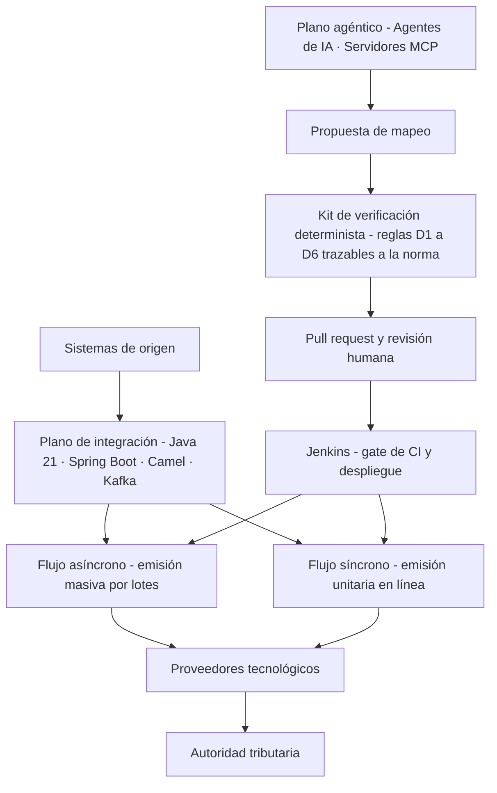

# Veriagent eInvoice LATAM

### Planificación de una arquitectura agéntica verificable para facturación electrónica multipaís en Latinoamérica

---

Este repositorio contiene las entregas del **Trabajo de Fin de Grado** del programa de **Ingeniería Informática** de la **Fundación Universitaria Internacional de La Rioja (UNIR)**, desarrollado en la modalidad **Tipo 2: planificación de un proyecto de innovación tecnológica en el ámbito profesional**.

El trabajo planifica una arquitectura en la que **agentes de inteligencia artificial** proponen los mapeos que exige cada país y proveedor de facturación electrónica, mientras un **kit de verificación determinista**, trazable a la norma, decide qué propuesta puede llegar a **revisión humana** antes de desplegarse.

## Contenido del repositorio:

📁 **`entrega-1-borrador-inicial/`**
- `TFG_Entrega1_DeMendozaTovar_Final.pdf` → **Entrega 1 (borrador inicial)**: introducción, planteamiento del problema con análisis de Pareto, objetivos, elementos innovadores, situación de partida y análisis del problema.
- `TFG_Entrega1_DeMendozaTovar_Final.docx` → Versión editable en Word de la Entrega 1.

📁 **`entrega-2-borrador-intermedio/`**
- `TFG_Entrega2_DeMendozaTovar.pdf` → **Entrega 2 (borrador intermedio)**: incorpora la **metodología** completa sobre el contenido de la Entrega 1.
- `TFG_Entrega2_DeMendozaTovar.docx` → Versión editable en Word de la Entrega 2.

## Arquitectura

## Contenido de las entregas

**📁 Entrega 1 — Borrador inicial**
- Planteamiento del problema con **análisis de Pareto** de los defectos de mapeo.
- **Objetivo general y tres objetivos específicos** con resultado medible y plazo.
- Situación de partida con los **flujos asíncrono y síncrono** de la plataforma de integración.
- **Taxonomía propia de seis tipos de defecto de mapeo (D1 a D6)**.
- Análisis del problema: contextualización, antecedentes y trabajos relacionados.

**📁 Entrega 2 — Borrador intermedio**
- Enfoque de **investigación en ciencia del diseño** con fases encadenadas a los objetivos.
- Diagnóstico con **diagrama de Ishikawa** y **análisis de Pareto**.
- **Análisis de decisión multicriterio** para seleccionar la solución.
- Diseño arquitectónico con escenarios de calidad, **modelo C4** y registros de decisión.
- Validación con **banco de defectos por inyección** y métricas **GQM**.
- Planificación con **EDT, PERT, nivelación de recursos y simulación de Monte Carlo**.

## Consulta de los documentos:

1. Entrar a la carpeta de la entrega que se desea revisar.
2. Para lectura, abrir el archivo **PDF**.
3. Para revisión o edición, descargar el archivo **Word (.docx)**.
4. La Entrega 2 es acumulativa: contiene la Entrega 1 más la metodología.

## Confidencialidad

El caso de referencia está **anonimizado**: no se identifica ninguna organización, proveedor ni sistema real. Las cifras se presentan como órdenes de magnitud y los ejemplos usan datos sintéticos.

## Autor:

Este trabajo fue desarrollado en el marco del **Trabajo de Fin de Grado** de Ingeniería Informática — UNIR Colombia.

- ***Alejandro De Mendoza*** – [Perfil GitHub](https://github.com/AlejoTechEngineer)

---
