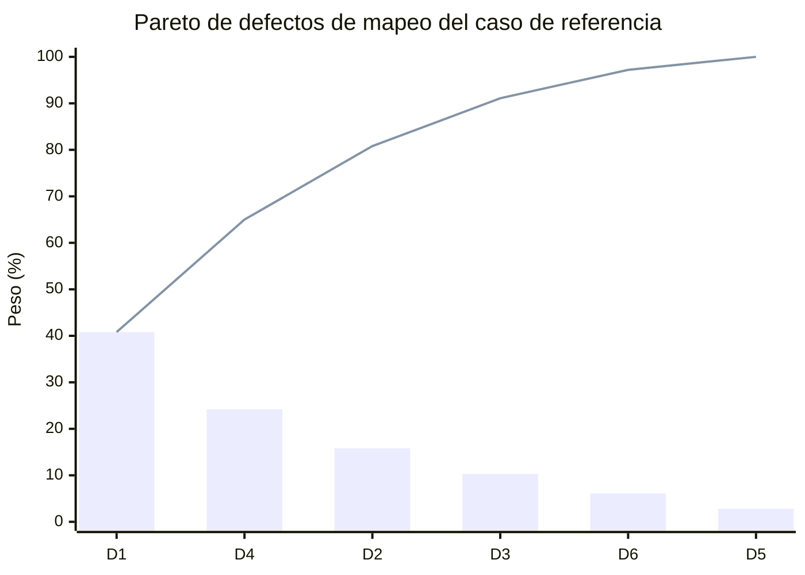
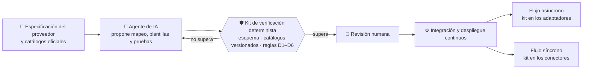
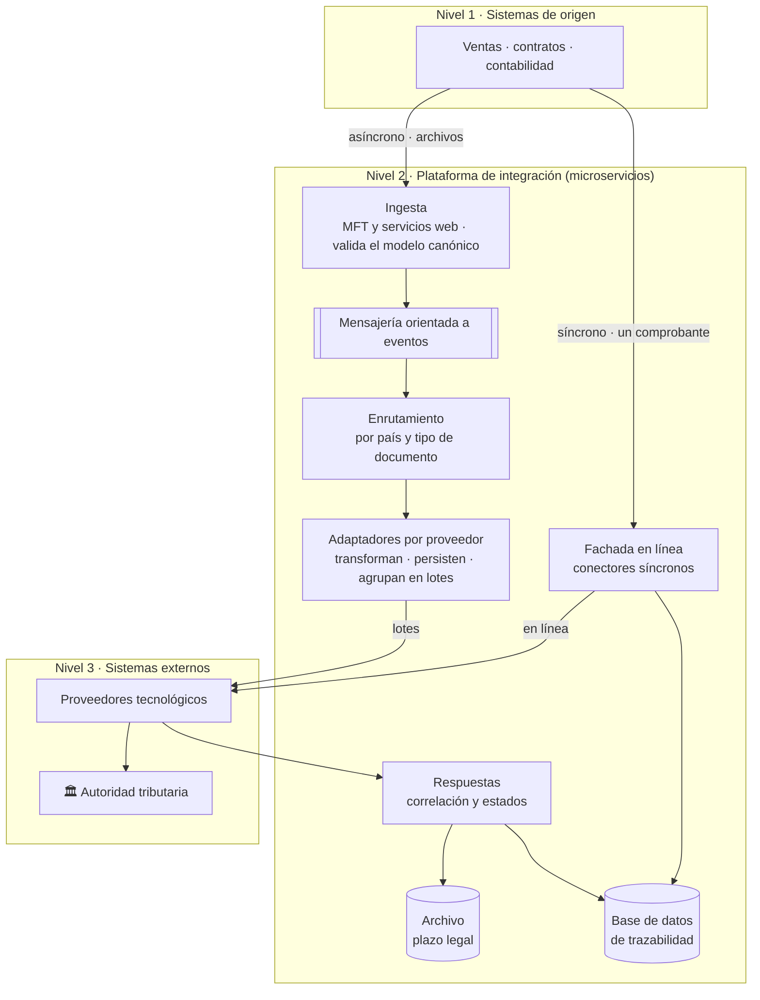
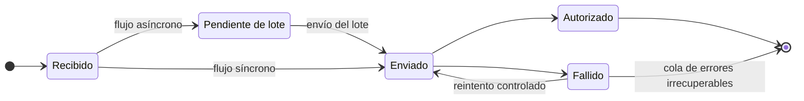

# 📕 Entrega 1 — Borrador Inicial

### *Planteamiento del problema, objetivos, elementos innovadores y análisis de la situación de partida*

**Veriagent eInvoice LATAM · Trabajo de Fin de Grado · Ingeniería Informática · UNIR**

**[⬅️ Repositorio](../README.md) • [Problema](#-planteamiento-del-problema) • [Objetivos](#-objetivos) • [Situación de partida](#-situación-de-partida) • [Taxonomía](#-taxonomía-de-defectos-d1d6) • [Análisis](#-análisis-del-problema) • [Entrega 2 ➡️](../entrega-2-borrador-intermedio/)**

---

## 📋 Tabla de Contenidos

- [🎯 Propósito de la Entrega](#-propósito-de-la-entrega)
- [📁 Archivos de esta Carpeta](#-archivos-de-esta-carpeta)
- [🗂️ Estructura del Documento](#️-estructura-del-documento)
- [🧩 Planteamiento del Problema](#-planteamiento-del-problema)
- [💡 Propuesta y Justificación](#-propuesta-y-justificación)
- [🏁 Objetivos](#-objetivos)
- [🌟 Elementos Innovadores](#-elementos-innovadores)
- [🏢 Situación de Partida](#-situación-de-partida)
- [😣 Puntos de Dolor](#-puntos-de-dolor)
- [🧬 Taxonomía de Defectos D1–D6](#-taxonomía-de-defectos-d1d6)
- [🔭 Análisis del Problema](#-análisis-del-problema)
- [➡️ Qué Incorpora la Entrega 2](#️-qué-incorpora-la-entrega-2)
- [📚 Referencias](#-referencias)
- [🔐 Confidencialidad](#-confidencialidad)
- [👤 Autor](#-autor)

---

## 🎯 Propósito de la Entrega

La **Entrega 1** construye la base del Trabajo de Fin de Grado: **qué problema se resuelve, por qué importa, qué se propone y qué se va a lograr**. Desarrolla por completo los capítulos 1 y 2. Los capítulos 3 a 6 quedan enunciados con su alcance y se desarrollan en las entregas siguientes.

> **Problema:** cada país o proveedor de facturación electrónica nuevo obliga a construir a mano el mapeo de unos **cien campos**, con defectos que solo se detectan cuando el comprobante es **rechazado**.
> **Propuesta:** agentes de IA que **proponen** mapeos, un **kit de verificación determinista** que los comprueba contra la norma y una **persona que aprueba**.
> **Resultado de la entrega:** problema medido con **Pareto**, **3 objetivos específicos** medibles, **5 elementos innovadores**, **7 puntos de dolor** y una **taxonomía propia de 6 tipos de defecto**.

### 🌟 ¿Qué deja establecido esta entrega?

- 📊 **El problema medido**: análisis de Pareto que muestra que **tres tipos de defecto explican el 80,8 %** de los casos.
- 🎯 **Objetivos verificables**: un objetivo general y tres específicos, cada uno con resultado medible y plazo.
- 🧬 **Una contribución original**: la taxonomía D1–D6, con regla de verificación y operador de mutación por tipo.
- 🏢 **La situación real de partida**: plataforma de integración con flujos **asíncrono** y **síncrono**, y un procedimiento tácito que explica buena parte de los defectos.
- 🔭 **El vacío en la literatura**: no se encontraron propuestas que combinen IA generativa, verificación determinista trazable a la norma y un plan de proyecto que gobierne ambas.

---

## 📁 Archivos de esta Carpeta

<table align="center">
  <tr><th>Archivo</th><th>Descripción</th></tr>
  <tr><td><code>TFG_Entrega1_DeMendozaTovar_Final.pdf</code></td><td>📕 <b>Versión de lectura</b> de la Entrega 1 (27 páginas)</td></tr>
  <tr><td><code>TFG_Entrega1_DeMendozaTovar_Final.docx</code></td><td>📝 <b>Versión editable</b> en Word, con índices, figuras y tablas</td></tr>
  <tr><td><code>README.md</code></td><td>📄 Este documento: resumen de lo que contiene la entrega</td></tr>
</table>

---

## 🗂️ Estructura del Documento

| Capítulo / Apartado | Contenido | Pág. | Estado |
|:---|:---|:---:|:---:|
| **Resumen · Abstract** | Síntesis del trabajo en español e inglés, con palabras clave | 2–3 | ✅ |
| **1. Introducción** | Problema, línea general de la solución y organización del documento | 7 | ✅ |
| &nbsp;&nbsp;1.1.1 Planteamiento del problema | Diversidad normativa, proceso manual y Pareto de defectos | 8 | ✅ |
| &nbsp;&nbsp;1.1.2 Descripción y justificación | Propuesta, justificación económica, organizacional y normativa | 9 | ✅ |
| &nbsp;&nbsp;1.2 Objetivos del TFG | Objetivo general, OE1–OE3, pregunta de investigación y alcance | 11 | ✅ |
| &nbsp;&nbsp;1.3 Elementos innovadores | Cinco contribuciones frente a lo existente | 12 | ✅ |
| **2. Situación de partida** | Organización de referencia y plataforma de integración | 14 | ✅ |
| &nbsp;&nbsp;2.2 Identificación del problema | Flujos, estados del comprobante, puntos de dolor y taxonomía | 15 | ✅ |
| &nbsp;&nbsp;2.3 Análisis del problema | Contextualización, antecedentes, trabajos relacionados y conclusiones | 18 | ✅ |
| **3. Metodología** | Enunciada; se desarrolla en la Entrega 2 | 22 | ⏳ |
| **4–6. Desarrollo, resultados y conclusiones** | Enunciados; se desarrollan en entregas posteriores | 22 | ⏳ |
| **Referencias bibliográficas** | 37 referencias en formato APA | 23 | ✅ |

<b>🖼️ Figuras y tablas de la entrega</b>

| Elemento | Título | Pág. |
|:---|:---|:---:|
| Figura 1 | Arquitectura propuesta: flujos de integración, kit de verificación y plano agéntico | 10 |
| Figura 2 | Arquitectura actual de integración: flujos asíncrono y síncrono | 15 |
| Figura 3 | Flujos actuales de emisión asíncrona y síncrona, estados del comprobante y origen de los defectos | 16 |
| Tabla 1 | Análisis de Pareto de los defectos de mapeo del caso de referencia | 9 |
| Tabla 2 | Puntos de dolor del proceso actual | 17 |
| Tabla 3 | Taxonomía de defectos de mapeo | 17 |
| Tabla 4 | Cobertura de las necesidades del problema por enfoque | 21 |

---

## 🧩 Planteamiento del Problema

La factura electrónica es obligatoria en la mayoría de los países de Latinoamérica: **más de quince** la han implementado, con un modelo de **control previo** en el que el comprobante debe ser validado antes de tener efectos fiscales. Por eso un error en una factura no es un problema de calidad de datos, sino **un documento rechazado o una contingencia fiscal**.

| Fuente del problema | Descripción |
|:---|:---|
| 🌎 **Diversidad normativa** | Cada país tiene su calendario, su esquema y sus catálogos, y los cambia por versiones (en Colombia, la Resolución 000165 de 2023 adoptó la versión 1.9 del anexo técnico; en Perú, la Resolución 188-2010/SUNAT inició el sistema). No existe en la región un modelo semántico común como la norma europea **EN 16931** |
| 🛠️ **Proceso manual** | Cada país o proveedor nuevo exige construir a mano el mapeo de **~100 campos** entre el modelo canónico y el formato del proveedor: **JSON**, **texto plano por segmentos** o **XML basado en UBL 2.1** |

### 📊 Análisis de Pareto

| Posición | Tipo | Defecto | Peso estimado | Acumulado |
|:---:|:---:|:---|:---:|:---:|
| 1 | **D1** | Código de catálogo incorrecto | 40,8 % | 40,8 % |
| 2 | **D4** | Campo exigido ausente en el modelo canónico | 24,2 % | 65,0 % |
| 3 | **D2** | Campos intercambiados o importes incoherentes | 15,8 % | **80,8 %** |
| 4 | **D3** | Literal mal formateado | 10,3 % | 91,1 % |
| 5 | **D6** | Carácter reservado en el contenido | 6,1 % | 97,2 % |
| 6 | **D5** | Campo obsoleto por versión del estándar | 2,8 % | 100,0 % |

Los pesos se estiman por **juicio experto** a partir de la experiencia del autor en el proyecto de integración del caso de referencia, y se calculan con el **método de centroide de rangos** (Barron y Barrett, 1996), porque el volumen de defectos hace inviable un conteo exhaustivo. **D1, D4 y D2 son los pocos vitales**: el kit de verificación prioriza sus reglas y el banco de defectos les asigna más casos.

**Áreas afectadas:**

| Área | Impacto |
|:---|:---|
| ⚙️ **Integración** | Semanas de trabajo por cada país o proveedor nuevo |
| 🧾 **Tributaria** | Interpreta la norma y valida catálogos sin una herramienta que conecte cada regla con su fuente |
| 💼 **Negocio** | Recibe rechazos tardíos y debe corregir los datos en origen |

---

## 💡 Propuesta y Justificación

En lugar de que una persona escriba el mapeo desde cero, un **agente** lee la especificación del proveedor, consulta los catálogos oficiales y propone la tabla de correspondencias, las plantillas y las pruebas. La propuesta **no se acepta por sí misma**: el kit la comprueba y solo si la supera pasa a revisión humana. La verificación opera en los **dos canales de emisión**: en el asíncrono, antes de agrupar y enviar los lotes; en el síncrono, antes de invocar al proveedor y con un tiempo de respuesta acotado.

| Dimensión | Justificación |
|:---|:---|
| 💰 **Económica** | El esfuerzo se repite por cada país y proveedor y crece de forma lineal; el plan incluye un **modelo de punto de equilibrio** para saber a partir de cuántas incorporaciones se recupera la inversión |
| 👥 **Organizacional** | El desarrollador pasa de transcribir especificaciones a **revisar propuestas con evidencia**; el especialista tributario, a **mantener reglas trazables**; el líder técnico **aprueba** cada cambio, con una matriz de responsabilidades |
| 🔄 **Procesos** | El conocimiento tácito (reglas en código heredado, códigos acordados en reuniones) se convierte en **reglas escritas, versionadas y verificables** |
| 🗃️ **Información** | Cada regla queda ligada a la sección y a la huella digital de la norma; un cambio de versión indica **qué reglas revisar** |
| 🏛️ **Política pública** | Coherente con el **CONPES 4144 de 2025**, que fija la mitigación de riesgos y el uso responsable de la IA como ejes estratégicos |

---

## 🏁 Objetivos

**Objetivo general.** Planificar la implementación de una arquitectura agéntica verificable para la incorporación de nuevos países y proveedores de facturación electrónica en Latinoamérica, validando su viabilidad técnica mediante un prototipo funcional evaluado con un banco de defectos inyectados.

| Objetivo específico | Resultado medible | Plazo |
|:---|:---|:---:|
| **OE1 · Caracterizar** los defectos de mapeo del proceso actual | Taxonomía de al menos **6 tipos**, cada uno con su regla de verificación y su operador de mutación | Semanas 1–3 |
| **OE2 · Diseñar** la arquitectura de referencia y el kit de verificación | Al menos **10 decisiones arquitectónicas** y detección mínima del **80 %** de los defectos inyectados en ejecución, **sin falsos positivos** | 4 semanas |
| **OE3 · Elaborar** el plan de ejecución del proyecto | EDT, cronograma nivelado, presupuesto, riesgos y CI/CD, con plazo y costo al **80 % de confianza** (Monte Carlo) | Cierre del TFG |

> ❓ **Pregunta de investigación:** ¿en qué medida una arquitectura agéntica con verificación determinista reduce el esfuerzo de incorporar un nuevo país o proveedor de facturación electrónica, manteniendo o mejorando la tasa de comprobantes válidos frente al proceso manual?

**Alcance.** El trabajo llega hasta el diseño de la arquitectura y la planificación de su implementación, y valida las decisiones críticas con un prototipo sobre una especificación y datos sintéticos. **No incluye** la operación en producción, la negociación con proveedores ni el uso de datos tributarios reales.

---

## 🌟 Elementos Innovadores

Según el **Manual de Oslo** (OCDE y Eurostat, 2006), el proyecto es una **innovación de proceso**: cambia la forma en que la organización incorpora países y proveedores de facturación electrónica.

| # | Elemento | Contribución |
|:---:|:---|:---|
| 1 | 🧬 **Taxonomía de defectos con reglas y operadores de mutación** | La literatura regional describe beneficios y desafíos, pero no una clasificación operativa de defectos de integración. D1–D6 sirve a la vez para diagnosticar, construir el verificador y evaluarlo |
| 2 | 🛡️ **Verificación determinista con procedencia normativa** | Un verificador que no depende del juicio del modelo: cada regla cita la sección y la huella digital del documento normativo |
| 3 | 🤖 **Ciclo gobernado para la IA** | Los agentes solo entregan solicitudes de cambio; no despliegan ni escriben en producción, y lo que no pasa el kit no se aprueba. Cada decisión queda registrada |
| 4 | 🧪 **Evaluación por inyección de defectos** | Pruebas de mutación aplicadas a mapeos de facturación: se mide qué porcentaje detecta cada mecanismo |
| 5 | 📈 **Planificación cuantitativa bajo incertidumbre** | Tres estimaciones por paquete, nivelación de carga y Monte Carlo: plazo y costo con su probabilidad, consumo de LLM y punto de equilibrio |

| Proceso | Alcance esperado |
|:---|:---|
| 🌎 Incorporación de países | Reducir el esfuerzo manual de mapeo y medirlo frente a una línea base |
| 🧾 Emisión | Que el **100 %** de los comprobantes pase la verificación antes de salir hacia el proveedor |
| 📜 Conocimiento normativo | Que cada regla sea trazable a su fuente |
| 🗓️ Gestión del proyecto | Que el plan comunique fechas y costos con su nivel de confianza |

---

## 🏢 Situación de Partida

La organización de referencia es una **empresa multinacional de servicios** con operación en varios países de Latinoamérica, que emite del orden de **cientos de miles de comprobantes al mes** (facturas, boletas y notas de crédito), con picos en los cierres de mes. Se describe en **tres niveles**: sistemas de origen, plataforma de integración y sistemas externos.

La plataforma sigue los **patrones de integración empresarial** (Hohpe y Woolf, 2003): modelo de datos canónico, enrutador basado en contenido y traductor de mensajes. Los dos flujos se interconectan en **tres puntos**: comparten la **base de datos de trazabilidad**, los **proveedores tecnológicos** y las **reglas de transformación**, de modo que **un defecto de mapeo afecta por igual a la emisión masiva y a la unitaria**.

### 🔄 Estados del comprobante

| Canal | Cómo se manifiesta un defecto de mapeo |
|:---|:---|
| 📦 **Asíncrono** (lotes) | Se descubre **tarde**: el lote ya se envió y regresa con rechazos masivos que deben corregirse en origen |
| ⚡ **Síncrono** (en línea) | Se descubre **de inmediato**, pero el error llega al usuario en el momento mismo de la transacción |

> En ambos casos el origen es el mismo, **el mapeo manual**, y por eso la verificación debe operar en los dos canales. Junto al procedimiento escrito existe un **procedimiento tácito** (códigos acordados en reuniones, reglas en código heredado, conocimiento de pocas personas y gestión de credenciales y accesos) que explica buena parte de los defectos y que la solución convierte en reglas explícitas.

---

## 😣 Puntos de Dolor

| # | Punto de dolor | Efecto | Respuesta de la propuesta |
|:---:|:---|:---|:---|
| **P1** | Mapeo manual de unos cien campos entre formatos | Semanas de trabajo por país y defectos recurrentes | 🤖 Agente de mapeo y kit de verificación |
| **P2** | Formatos heterogéneos: JSON, texto por segmentos y XML | Un adaptador distinto por proveedor | 🧱 Arquetipo de adaptador |
| **P3** | Datos de origen incompletos que se corrigen en origen | Rechazos que regresan tarde | 🛡️ Verificación en ejecución y clasificación de fallos |
| **P4** | Reglas ocultas en código heredado | Conocimiento tácito y riesgo de omisión | 🔎 Agente de extracción de reglas con evidencia |
| **P5** | Credenciales, llaves, puertos y accesos | Del orden de una semana por gestión | 🗓️ Planificación temprana y en paralelo |
| **P6** | Coordinación entre muchos actores | Esperas y retrabajo | 👥 Matriz de responsabilidades y gestión de interesados |
| **P7** | El ciclo se repite por país y por proveedor | Costo que crece de forma lineal | ♻️ Arquetipo, kit y agentes reutilizables |

No todos los puntos de dolor se resuelven con IA: P5 y P6 son de **gestión** y se atienden con el plan del proyecto.

---

## 🧬 Taxonomía de Defectos D1–D6

El punto de dolor **P1** es el núcleo técnico del problema. Sus defectos se clasifican en una **taxonomía propia**: cada tipo tiene una regla que el kit implementa y un operador de mutación para evaluarlo.

| Tipo | Defecto | Ejemplo genérico | Regla de verificación | Operador de mutación |
|:---:|:---|:---|:---|:---|
| **D1** | Código de catálogo incorrecto | Código tomado de una nota verbal y no de la especificación | Catálogo oficial versionado y coherencia entre campos | Sustituir por otro código, válido o inexistente |
| **D2** | Campos intercambiados | Monto, cantidad y precio unitario cruzados | Invariantes aritméticas y ejemplos validados | Permutar dos campos o tomar un total equivocado |
| **D3** | Literal mal formateado | Mayúsculas, espacios o nombre de parámetro | Literales y listas cerradas con comparación exacta | Alterar mayúsculas o añadir espacios |
| **D4** | Campo exigido ausente en el canónico | Dato obligatorio que el modelo canónico no trae | Cobertura del esquema destino y campos no vacíos | Eliminar el mapeo o mapear a un valor vacío |
| **D5** | Campo obsoleto por versión | Campo retirado en la versión vigente del estándar | Esquema vigente y lista de elementos retirados | Añadir un elemento de la versión anterior |
| **D6** | Carácter reservado en el contenido | Separador del formato dentro de un texto libre | Conteo de campos y datos adversarios | Desactivar el saneamiento de un texto libre |

> 💡 **Hallazgo de diseño:** un código de catálogo **válido pero equivocado** no lo detecta la validación de esquema, porque en UBL los códigos son cadenas de texto libres. Solo lo detecta una regla de negocio que conozca la semántica del catálogo o la comparación con ejemplos validados por personas.

El problema queda identificado en **tres dimensiones**: **técnica** (el mapeo manual introduce defectos que el esquema no detecta), **organizacional** (el conocimiento está repartido entre pocas personas) y **de gestión** (el calendario depende de trámites de acceso). La arquitectura ataca las dos primeras y el plan del proyecto, la tercera.

---

## 🔭 Análisis del Problema

### 📖 Contextualización

| Concepto | Definición en el trabajo |
|:---|:---|
| 🧾 **Factura electrónica con validación previa** | Comprobante fiscal digital que la autoridad, o un intermediario autorizado, valida antes de que tenga efectos legales |
| 📐 **UBL y modelo semántico** | UBL 2.1 (OASIS) define documentos comerciales en XML y es base de varios perfiles nacionales; EN 16931-1 define en Europa un modelo semántico común |
| 🔀 **Integración orientada a eventos** | Sistemas conectados por mensajes asíncronos y patrones reutilizables; el **traductor de mensajes** es justo el componente que hoy se escribe a mano |
| ✅ **Verificación del software** | Validar es construir el producto correcto; **verificar** es comprobar que cumple su especificación. El kit es un mecanismo de verificación automático |
| 🤖 **LLM y agentes** | Un agente alterna razonamiento y acciones sobre herramientas (ReAct); el **Model Context Protocol** estandariza su acceso a herramientas y datos |
| 👻 **Alucinación** | Contenido plausible pero falso; la generación aumentada con recuperación (RAG) la reduce, pero no la elimina |
| 🚀 **Integración y despliegue continuos** | Prácticas DevOps que automatizan construcción, pruebas y despliegue; aquí, el canal donde el kit es **control obligatorio** |

### 🌐 Antecedentes

| Ámbito | Hallazgos |
|:---|:---|
| 🌍 **Internacional** | La OCDE trata la factura electrónica como pieza de la administración tributaria digital; el BID describe la administración tributaria 3.0; Europa adoptó EN 16931; el **NIST AI RMF** organiza el riesgo de IA en gobernar, mapear, medir y gestionar |
| 🌎 **Regional** | Latinoamérica es pionera: experiencias documentadas por Barreix y Zambrano (2018), evaluación de impacto en Ecuador, automatización de controles en Perú y equivalencia funcional en Chile |
| 🇨🇴 **Nacional** | La DIAN regula con anexos técnicos versionados (v1.9, Resolución 000165 de 2023, y ajuste de plazos en 2024); el **CONPES 4144 de 2025** fija la política nacional de IA |
| 🏢 **Local** | La incorporación sucesiva de países y proveedores con el procedimiento manual del caso de referencia y sus defectos registrados |

### 🔬 Trabajos relacionados

| Tema | Lo que aporta la literatura | Lo que falta |
|:---|:---|:---|
| **a) Emparejamiento de esquemas con LLM** | Narayan et al. (2022), Parciak et al. (2024) y Liu et al. (2025): los LLM aceleran el emparejamiento | Producen correspondencias, no transformaciones ejecutables, y no se han aplicado a formatos tributarios con catálogos versionados |
| **b) LLM en ingeniería de software** | Hou et al. (2024), Quevedo-Tumailli et al. (2025) y Jimenez et al. (2024): mejoran la productividad y se evalúan mejor con oráculos ejecutables | Exigen supervisión humana rigurosa |
| **c) Fiabilidad y verificación** | Huang et al. (2025) sobre alucinación; Jia y Harman (2011) sobre pruebas de mutación | Ninguno aborda la verificación de mapeos tributarios |
| **d) Tecnología en factura electrónica** | Impacto fiscal, marco normativo y adopción | Los trabajos con LLM se ocupan de extraer datos de facturas, no de integrar sistemas |

| Enfoque | Automatiza el mapeo | Garantiza validez normativa | Trazabilidad a la norma | Gobierno de la IA |
|:---|:---:|:---:|:---:|:---:|
| Plataforma comercial de facturación | Parcial | Sí, en su formato | Opaca para el cliente | No aplica |
| Desarrollo tradicional | No | Sí, si se programan las reglas | Solo si se documenta | No aplica |
| Emparejamiento con LLM | Sí, correspondencias | No | No | No tratado |
| Agentes de código | Sí, código y pruebas | Solo con pruebas existentes | No | Parcial |
| **Arquitectura propuesta** | ✅ **Sí, gobernado** | ✅ **Verificación obligatoria** | ✅ **Regla a fuente** | ✅ **NIST y CONPES 4144** |

### 🧠 Conclusiones del análisis

1. **El problema es estructural en la región**: la validación previa es obligatoria, los formatos son nacionales y cambian por versiones, y no hay un modelo semántico común.
2. **Los LLM pueden acelerar el mapeo**, pero la literatura coincide en que sus resultados requieren verificación y supervisión humana, y la alucinación no desaparece.
3. **Existe un vacío**: no se encontraron propuestas que combinen generación de mapeos con IA, verificación determinista trazable a la norma y un plan de proyecto que gobierne ambas. **Ese vacío es el espacio que ocupa este trabajo.**

---

## ➡️ Qué Incorpora la Entrega 2

La Entrega 1 deja enunciado el capítulo 3. La [**Entrega 2**](../entrega-2-borrador-intermedio/) lo desarrolla por completo:

| Anunciado en la Entrega 1 | Desarrollado en la Entrega 2 |
|:---|:---|
| Investigación en ciencia del diseño y ciclo de vida por fases | ✅ Enfoque de Hevner y Peffers con fases 0–4 encadenadas a los objetivos |
| Diagrama de Ishikawa de las causas de rechazo | ✅ Seis categorías adaptadas al dominio de la integración |
| Análisis de decisión multicriterio | ✅ Cinco alternativas, seis criterios y análisis de sensibilidad |
| Estimación de tres puntos con Monte Carlo | ✅ EDT, PERT, nivelación por recursos y simulación |
| Banco de defectos por inyección | ✅ Pruebas de mutación y métricas GQM |

---

## 📚 Referencias

La entrega se apoya en **37 referencias** en formato APA: normativa oficial (DIAN, SUNAT, CEN, OASIS), organismos internacionales (BID, OCDE, NIST), política pública (CONPES 4144), literatura regional sobre factura electrónica y literatura sobre LLM, agentes y verificación.

<b>Ver selección de referencias</b>

- Barreix, A. y Zambrano, R. (Eds.) (2018). *Factura electrónica en América Latina*. BID y CIAT.
- Barron, F. H. y Barrett, B. E. (1996). Decision quality using ranked attribute weights. *Management Science, 42*(11).
- Departamento Nacional de Planeación (2025). *Documento CONPES 4144: Política Nacional de Inteligencia Artificial*.
- Dirección de Impuestos y Aduanas Nacionales (2023). *Resolución 000165 de 2023*.
- Hohpe, G. y Woolf, B. (2003). *Enterprise integration patterns*.
- Hou, X. et al. (2024). Large language models for software engineering: A systematic literature review. *ACM TOSEM, 33*(8).
- Huang, L. et al. (2025). A survey on hallucination in large language models. *ACM Transactions on Information Systems, 43*(2).
- Jia, Y. y Harman, M. (2011). An analysis and survey of the development of mutation testing. *IEEE Transactions on Software Engineering*.
- Leguizamón, J. D. y Lugo, S. (2024). Implementación de la facturación electrónica en América Latina: revisión de literatura. *Arandu UTIC*.
- Narayan, A. et al. (2022). Can foundation models wrangle your data? *Proceedings of the VLDB Endowment, 16*(4).
- National Institute of Standards and Technology (2023). *AI Risk Management Framework (AI RMF 1.0)*.
- OASIS (2013). *Universal Business Language Version 2.1*.
- OCDE y Eurostat (2006). *Manual de Oslo*.
- Parciak, M. et al. (2024). Schema matching with large language models: An experimental study.
- Yao, S. et al. (2023). ReAct: Synergizing reasoning and acting in language models.

La lista completa está en el capítulo **Referencias Bibliográficas** del documento.

---

## 🔐 Confidencialidad

- El caso de referencia está **anonimizado**: no se identifica ninguna organización, proveedor ni sistema real.
- Las cifras se presentan como **órdenes de magnitud** y los pesos del análisis de Pareto son **estimaciones por juicio experto**, no mediciones.
- Los ejemplos de la taxonomía son **genéricos** y no provienen de datos tributarios reales.

---

## 👤 Autor

Entrega desarrollada como parte del **Trabajo de Fin de Grado** del programa de **Ingeniería Informática** de la **Fundación Universitaria Internacional de La Rioja (UNIR)**, sede Colombia (Bogotá D. C.), bajo la dirección de **Johan Sebastián Giraldo Hurtado**.

 

### Alejandro De Mendoza Tovar

**Ingeniero Senior de Integraciones y Plataformas · Desarrollador Backend y Full Stack**

| Autor | Perfil |
|:---:|:---:|
| ***Alejandro De Mendoza Tovar*** |  |

---

### 📕 *Antes de resolver un problema, hay que medirlo*

**[⬅️ Volver al repositorio](../README.md) · [Ir a la Entrega 2 ➡️](../entrega-2-borrador-intermedio/)**

**Entrega 1 · Borrador inicial · Veriagent eInvoice LATAM · UNIR · 2026**

