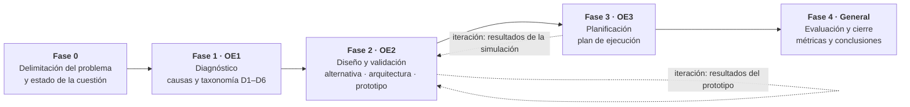
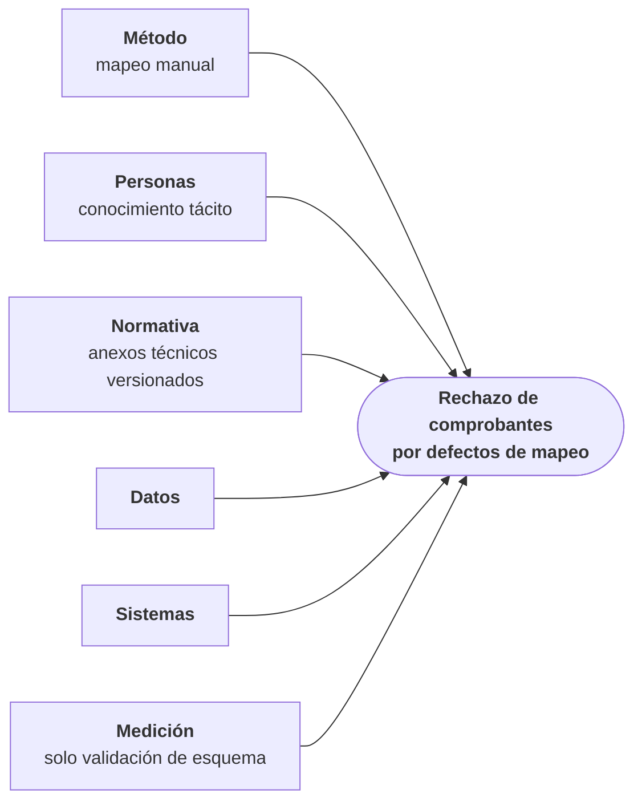
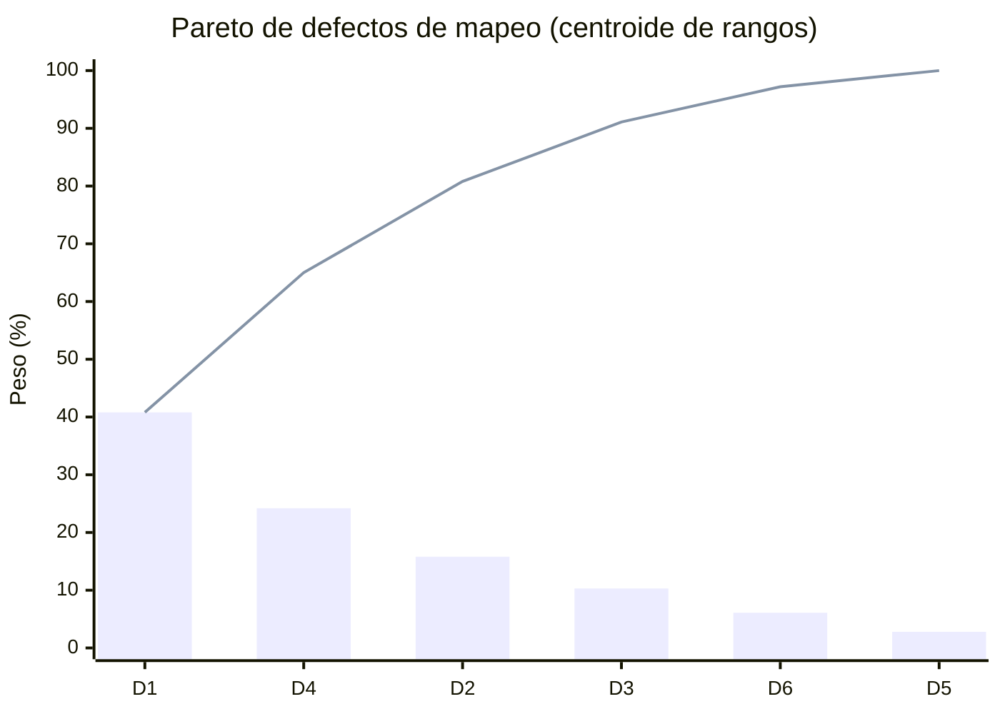
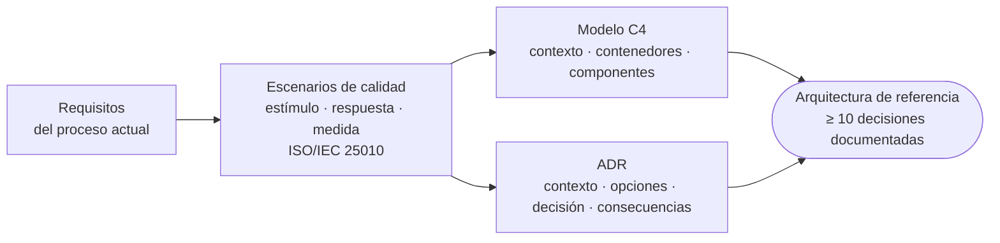
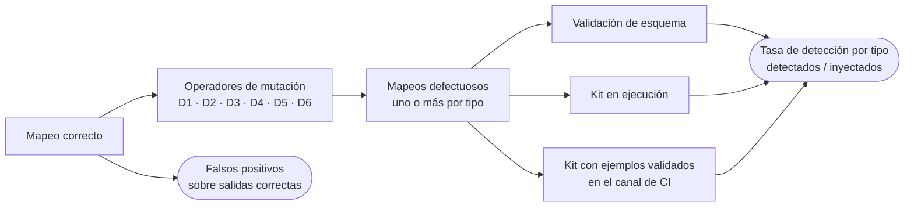
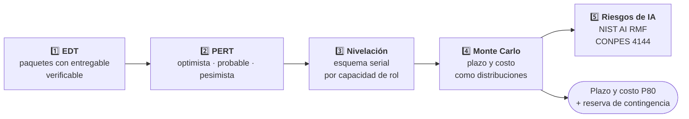

# Entrega 2 — Borrador Intermedio

### *Metodología completa: diagnóstico, decisión, diseño, validación y planificación cuantitativa del proyecto*

**Veriagent eInvoice LATAM · Trabajo de Fin de Grado · Ingeniería Informática · UNIR**

**[Entrega 1](../entrega-1-borrador-inicial/) • [Repositorio](../README.md) • [Enfoque](#enfoque-metodológico) • [Diagnóstico](#métodos-de-diagnóstico) • [Diseño](#métodos-de-diseño-arquitectónico) • [Validación](#método-de-validación-técnica) • [Planificación](#métodos-de-planificación)**

---

## Tabla de Contenidos

- [Propósito de la Entrega](#propósito-de-la-entrega)
- [Archivos de esta Carpeta](#archivos-de-esta-carpeta)
- [Novedades frente a la Entrega 1](#novedades-frente-a-la-entrega-1)
- [Estructura del Documento](#estructura-del-documento)
- [Enfoque Metodológico](#enfoque-metodológico)
- [Revisión de la Literatura](#revisión-de-la-literatura)
- [Métodos de Diagnóstico](#métodos-de-diagnóstico)
- [Método de Decisión](#método-de-decisión)
- [Métodos de Diseño Arquitectónico](#métodos-de-diseño-arquitectónico)
- [Método de Validación Técnica](#método-de-validación-técnica)
- [Métricas GQM](#métricas-gqm)
- [Métodos de Planificación](#métodos-de-planificación)
- [Trazabilidad Objetivos → Entregables](#trazabilidad-objetivos--entregables)
- [Inicio del Capítulo 4: Primeras Evidencias](#inicio-del-capítulo-4-primeras-evidencias)
- [Próximas Entregas](#próximas-entregas)
- [Referencias](#referencias)
- [Confidencialidad](#confidencialidad)
- [Autor](#autor)

---

## Propósito de la Entrega

La **Entrega 2** responde a la pregunta **cómo se va a hacer el trabajo**. Desarrolla por completo el capítulo 3, **Metodología**, sobre el contenido de la Entrega 1, y justifica cada método por la necesidad concreta que atiende de los objetivos específicos: **diagnosticar** el problema con evidencia, **decidir** la solución sin subjetividad, **diseñarla** de forma verificable y **planificar** su ejecución con plazos y costos cuantificados. Además, **inicia el capítulo 4** con la aportación del trabajo y las **primeras evidencias** del prototipo.

> **Enfoque:** investigación en ciencia del diseño, con un ciclo de vida por fases y un entregable al final de cada una.
> **Diseño:** mixto. Cualitativo (análisis de causas, juicio experto) y cuantitativo (simulación y medición de la detección de defectos).
> **Resultado de la entrega:** **8 apartados metodológicos**, **5 fases**, **5 métricas GQM** una **matriz de trazabilidad** que conecta cada objetivo con su método y su entregable, y un **banco de 22 defectos inyectados** con sus primeros resultados.

### ¿Qué deja establecido esta entrega?

- **Un marco de investigación riguroso**: *design science research* con el proceso de seis actividades de Peffers et al. (2007).
- **Un diagnóstico con dos lentes**: Ishikawa para las causas y Pareto para priorizar.
- **Una decisión reproducible**: matriz multicriterio con cinco alternativas, seis criterios y análisis de sensibilidad.
- **Un diseño justificable**: escenarios de calidad ISO/IEC 25010, modelo C4 y registros de decisión (ADR).
- **Una validación objetiva**: banco de defectos por inyección con pruebas de mutación y métricas GQM.
- **Un plan cuantitativo**: EDT, PERT, nivelación por recursos, Monte Carlo y riesgos de IA según NIST.
- **Una primera evidencia medible**: el kit detecta el 86 % de los defectos en ejecución y el 100 % con integración continua, sin falsos positivos.

---

## Archivos de esta Carpeta

<table align="center">
  <tr><th>Archivo</th><th>Descripción</th></tr>
  <tr><td><code>TFG_Entrega2_DeMendozaTovar_Final.pdf</code></td><td><b>Versión de lectura</b> de la Entrega 2 (37 páginas)</td></tr>
  <tr><td><code>TFG_Entrega2_DeMendozaTovar_Final.docx</code></td><td><b>Versión editable</b> en Word, con índices de contenidos, figuras y tablas</td></tr>
  <tr><td><code>README.md</code></td><td>Este documento: resumen de lo que contiene la entrega</td></tr>
</table>

---

## Novedades frente a la Entrega 1

| Elemento | Entrega 1 | Entrega 2 |
|:---|:---:|:---:|
| **Capítulo 3 · Metodología** | Enunciado | **8 apartados completos** |
| **Figuras** | 3 | **5** · nuevas: fases de la metodología (Fig. 4) y diagrama de Ishikawa (Fig. 5) |
| **Capítulo 4 · Desarrollo de la solución** | Enunciado | **Iniciado**: aportación, primeras evidencias y avance por objetivo (4.1 a 4.3) |
| **Tablas** | 4 | **8** · nuevas: protocolo de búsqueda (T5), métricas GQM (T6), trazabilidad (T7) y resultados del banco de defectos (T8) |
| **Referencias** | 37 | **53** · 16 nuevas sobre metodología, arquitectura y gestión de proyectos |
| **Páginas** | 27 | **37** |
| **Capítulos 1 y 2** | Completos | Se conservan; la revisión de la literatura remite ahora al apartado 3.2 |

---

## Estructura del Documento

| Capítulo / Apartado | Contenido | Pág. | Estado |
|:---|:---|:---:|:---:|
| **1. Introducción** | Problema, justificación, objetivos y elementos innovadores | 8 | |
| **2. Situación de partida** | Organización de referencia, puntos de dolor, taxonomía y análisis | 15 | |
| **3. Metodología** | **Novedad de esta entrega** | **23** | |
| &nbsp;&nbsp;3.1 Enfoque metodológico y fases | Ciencia del diseño, ciclo de vida por fases y diseño mixto | 23 | |
| &nbsp;&nbsp;3.2 Revisión de la literatura | Protocolo de búsqueda inspirado en PRISMA 2020 | 24 | |
| &nbsp;&nbsp;3.3 Métodos de diagnóstico | Diagrama de Ishikawa y análisis de Pareto | 24 | |
| &nbsp;&nbsp;3.4 Método de decisión | Análisis de decisión multicriterio | 26 | |
| &nbsp;&nbsp;3.5 Métodos de diseño arquitectónico | Requisitos, escenarios de calidad, C4 y ADR | 26 | |
| &nbsp;&nbsp;3.6 Método de validación técnica | Prototipo, pruebas de mutación y GQM | 27 | |
| &nbsp;&nbsp;3.7 Métodos de planificación | EDT, PERT, nivelación, Monte Carlo y riesgos de IA | 28 | |
| &nbsp;&nbsp;3.8 Trazabilidad | Objetivos, fases, métodos y entregables | 29 | |
| **4. Desarrollo de la solución** | **Iniciado en esta entrega** | **29** | |
| &nbsp;&nbsp;4.1 Aportación | Taxonomía de defectos y kit de verificación | 29 | |
| &nbsp;&nbsp;4.2 Primeras evidencias | Banco de defectos por inyección | 30 | |
| &nbsp;&nbsp;4.3 Avance frente a los objetivos | Estado de OE1, OE2 y OE3 | 30 | |
| **5–6. Resultados y conclusiones** | Se desarrollan en entregas posteriores | 31 | |
| **Referencias bibliográficas** | 53 referencias en formato APA | 32 | |

<b>Figuras y tablas de la entrega</b>

| Elemento | Título | Pág. |
|:---|:---|:---:|
| Figura 1 | Arquitectura propuesta: flujos de integración, kit de verificación y plano agéntico | 11 |
| Figura 2 | Arquitectura actual de integración: flujos asíncrono y síncrono | 16 |
| Figura 3 | Flujos actuales de emisión asíncrona y síncrona, estados del comprobante y origen de los defectos | 17 |
| Figura 4 | Fases de la metodología, objetivos y entregables | 23 |
| Figura 5 | Diagrama Ishikawa rechazo de comprobantes por defectos de mapeo | 25 |
| Tabla 1 | Análisis de Pareto de los defectos de mapeo del caso de referencia | 10 |
| Tabla 2 | Puntos de dolor del proceso actual | 18 |
| Tabla 3 | Taxonomía de defectos de mapeo | 18 |
| Tabla 4 | Cobertura de las necesidades del problema por enfoque | 22 |
| Tabla 5 | Protocolo de búsqueda de la literatura | 24 |
| Tabla 6 | Métricas de evaluación derivadas con el enfoque GQM | 28 |
| Tabla 7 | Trazabilidad entre objetivos, fases, métodos y entregables | 29 |
| Tabla 8 | Resultados del banco de defectos por mecanismo de verificación | 30 |

---

## Enfoque Metodológico

El trabajo sigue la **investigación en ciencia del diseño** (*design science research*), propia de los sistemas de información, que estudia la creación de **artefactos** que resuelven problemas relevantes y exige evaluarlos con rigor (Hevner et al., 2004). Es adecuada porque la contribución del trabajo es un artefacto tecnológico, la arquitectura con su kit de verificación y su plan de implementación, y no la explicación de un fenómeno.

| Actividad (Peffers et al., 2007) | En este trabajo |
|:---:|:---|
| 1️⃣ Identificar el problema | Capítulos 1 y 2: problema, puntos de dolor y Pareto |
| 2️⃣ Definir los objetivos de la solución | Objetivo general y OE1–OE3 con resultado medible |
| 3️⃣ Diseñar y desarrollar | Arquitectura de referencia y kit de verificación |
| 4️⃣ Demostrar | Prototipo funcional sobre una especificación y datos sintéticos |
| 5️⃣ Evaluar | Banco de defectos por inyección y métricas GQM |
| 6️⃣ Comunicar | Documento del TFG y sus entregas |

Para organizar el trabajo en el tiempo, el proceso se concreta en un **ciclo de vida por fases** con un entregable al final de cada una, **secuencial entre fases e iterativo dentro de ellas**, similar al modelo híbrido que Giraldo-Hurtado (2023) aplicó para construir y validar un catálogo de herramientas con un prototipo funcional.

| Fase | Objetivo | Qué produce |
|:---:|:---:|:---|
| **0** | — | Problema delimitado y estado de la cuestión |
| **1** | OE1 | Causas de los defectos priorizadas y taxonomía D1–D6 |
| **2** | OE2 | Alternativa seleccionada, arquitectura diseñada y prototipo que la valida |
| **3** | OE3 | Plan de ejecución del proyecto |
| **4** | General | Evaluación frente a las métricas definidas y conclusiones |

El diseño es **mixto** (Hernández Sampieri et al., 2014): combina técnicas cualitativas, como el análisis de causas y el juicio experto, con técnicas cuantitativas, como la simulación y la medición de la detección de defectos.

---

## Revisión de la Literatura

Protocolo de búsqueda **inspirado en PRISMA 2020** (Page et al., 2021): documenta fuentes, cadenas y criterios para que la revisión sea **transparente y reproducible**. No es una revisión sistemática completa, que excede el alcance de un trabajo de planificación, sino una **búsqueda estructurada** que garantiza que los antecedentes provienen de fuentes verificables.

| Fuente | Cadena o criterio de búsqueda | Propósito |
|:---|:---|:---|
| IEEE Xplore · ACM DL · Scopus | `("schema matching" OR "data mapping") AND ("large language model" OR LLM)` | Emparejamiento de esquemas con LLM |
| IEEE Xplore · ACM DL · ScienceDirect | `("LLM-based agent" OR "AI agent") AND ("software engineering" OR "code generation")` | Agentes y LLM en ingeniería de software |
| Scopus · ScienceDirect | `(hallucination OR "factual consistency") AND ("large language model") AND (verification OR survey)` | Fiabilidad y verificación |
| Redalyc · SciELO · Dialnet · Google Académico | `("factura electrónica" OR "facturación electrónica") AND ("América Latina" OR Latinoamérica)` | Factura electrónica en la región |
| Sitios oficiales (DIAN, SUNAT, BID, CIAT, OCDE) | Normativa, anexos técnicos e informes vigentes | Marco normativo y antecedentes |
| Re-UNIR y repositorios institucionales | `("DevOps" OR "GitOps" OR "integración continua")` en trabajos de grado y maestría | Antecedentes académicos de integración y despliegue |

| Inclusión | Exclusión |
|:---|:---|
| Publicaciones revisadas por pares, normativa oficial y documentos técnicos de organismos reconocidos | Textos de opinión y duplicados |
| En español o en inglés | Trabajos sin acceso al texto completo |
| Publicados desde 2018, salvo los trabajos fundacionales de cada tema | Trabajos que usan LLM solo para extraer datos de facturas escaneadas |

---

## Métodos de Diagnóstico

### Diagrama de Ishikawa

El diagrama de causa y efecto (Ishikawa, 1986) se selecciona porque **el rechazo de comprobantes no tiene una causa única**, y obliga a considerar todas las dimensiones antes de proponer una solución, sin atribuir el problema solo a la tecnología. Las categorías clásicas se adaptan al dominio de la integración de facturación electrónica.

>**Las causas se refuerzan entre sí.** El mapeo manual (*método*) depende de conocimiento tácito (*personas*) para interpretar anexos técnicos versionados (*normativa*), y la única barrera antes del envío es la validación de esquema (*medición*), que no detecta códigos válidos pero equivocados. Por eso la solución combina **un cambio de método** (propuesta asistida por agentes) con **un cambio de medición** (verificación determinista), y no solo uno de los dos. El diagrama completo es la **Figura 5** del documento.

### Análisis de Pareto

Ordena los tipos de defecto por frecuencia para separar **los pocos vitales de los muchos útiles** (Juran, 1990). Como en un desarrollo de esta escala el volumen de incidencias hace inviable un conteo exhaustivo, el autor ordena los seis tipos por **juicio experto** y el orden se convierte en pesos con el **método de centroide de rangos** (Barron y Barrett, 1996). El resultado se declara como **estimación, no como medición**.

---

## Método de Decisión

La alternativa de solución se selecciona con un **análisis de decisión multicriterio** en forma de **matriz de decisión ponderada**: definir criterios, asignar pesos, puntuar cada alternativa y calcular un total ponderado (Romero, 1993). Elimina la subjetividad de una elección por preferencia y es el procedimiento del área **DAR (análisis y resolución de decisiones) de CMMI** (CMMI Product Team, 2010).

| Alternativas comparadas | Criterios de evaluación |
|:---|:---|
| Plataforma comercial de facturación | Validez normativa de lo emitido |
| Plataforma de integración como servicio | Esfuerzo por país o proveedor nuevo |
| Desarrollo tradicional sin IA | Control y trazabilidad |
| Modelos de lenguaje sin verificación | Costo total de propiedad |
| **Arquitectura propuesta** | Riesgo de implantación |
| | Independencia del fabricante |

>**Análisis de sensibilidad:** se varía el peso del criterio más débil de la alternativa ganadora hasta encontrar el valor a partir del cual la decisión cambiaría. Así se comprueba que la elección es **robusta**.

---

## Métodos de Diseño Arquitectónico

Tres métodos complementarios permiten **justificar** cada elemento de la arquitectura con un escenario de calidad y una decisión documentada, y no solo describirlo.

| # | Método | Fuente | Para qué |
|:---:|:---|:---|:---|
| 1 | **Levantamiento de requisitos funcionales** | Kendall y Kendall (2011) | Derivar los requisitos del análisis del proceso actual |
| 2 | **Escenarios de calidad** *estímulo → respuesta → medida*, clasificados según **ISO/IEC 25010** | Bass et al. (2021) · ISO/IEC (2023) | Convertir requisitos difusos en metas verificables: de "que sea confiable" a **"cero comprobantes perdidos ante un reproceso"** |
| 3 | **Modelo C4** y **registros de decisión arquitectónica (ADR)** | Brown (s. f.) · Nygard (2011) | Documentar por niveles para audiencias distintas y registrar contexto, opciones, decisión y consecuencias |

---

## Método de Validación Técnica

La viabilidad técnica se valida con un **prototipo funcional** del kit de verificación y del ciclo gobernado de propuestas, construido sobre **una especificación y datos sintéticos**. El prototipo no sustituye al proyecto: su función es **reducir el riesgo técnico** de las decisiones críticas antes de comprometer recursos.

La evaluación aplica **pruebas de mutación** (Jia y Harman, 2011): a partir de un mapeo correcto se generan versiones defectuosas, **una o más por cada tipo de la taxonomía**, y se mide qué porcentaje detecta cada mecanismo.

---

## Métricas GQM

Las métricas se derivan con el enfoque **objetivo · pregunta · métrica** (Basili et al., 1994): cada métrica responde a una pregunta asociada a un objetivo, **para no medir por medir**.

| Objetivo | Pregunta | Métrica | Meta |
|:---|:---|:---|:---|
| **OE1** · Caracterizar | ¿Qué tipos de defecto concentran la mayoría de los rechazos? | Peso relativo por tipo (Pareto) | Identificar los tipos que suman al menos el **80 %** |
| **OE2** · Diseñar | ¿Qué proporción de los defectos detecta el kit? | Defectos detectados / defectos inyectados, por tipo | **≥ 80 %** en ejecución y **100 %** con fixtures de CI |
| **OE2** · Diseñar | ¿Rechaza el kit comprobantes correctos? | Falsos positivos sobre salidas correctas | **Cero** |
| **OE3** · Elaborar | ¿Cuál es el plazo y el costo con un nivel de confianza conocido? | Duración y costo en el percentil 80 de la simulación | Plazo **P80 ≤ 12 meses** |
| **General** | ¿Se recupera la inversión frente al proceso manual? | Punto de equilibrio **n\*** en número de países o proveedores | Calcular n\* y contrastarlo con los países previstos |

---

## Métodos de Planificación

La planificación, **contribución central** de un trabajo de este tipo, se construye con **cinco métodos encadenados**:

| # | Método | Fuente | Por qué |
|:---:|:---|:---|:---|
| 1 | **Estructura de desglose del trabajo (EDT)** | PMI (2021) | Descompone el proyecto en paquetes con un entregable verificable cada uno |
| 2 | **PERT** · `tₑ = (o + 4m + p) / 6` | Malcolm et al. (1959) | Tres valores por paquete reflejan la incertidumbre de cada estimación |
| 3 | **Nivelación por recursos** con esquema serial de generación de cronogramas | Kolisch (1996) | Un plan que asigna a una persona más trabajo del que puede hacer **no es ejecutable** |
| 4 | **Simulación de Monte Carlo** sobre la red nivelada | Gray y Larson (2009) | Miles de repeticiones con duraciones aleatorias: fechas y presupuesto **con su nivel de confianza** y reserva de contingencia |
| 5 | **Registro de riesgos de IA** por funciones *gobernar · mapear · medir · gestionar* | NIST (2023) · DNP (2025) | El riesgo de la IA se gestiona con responsables y respuestas, no como una advertencia técnica |

---

## Trazabilidad Objetivos → Entregables

Cada objetivo específico tiene **al menos un método** que lo desarrolla y **un entregable** que lo evidencia, para verificar su cumplimiento en las conclusiones.

| Objetivo | Fase | Métodos | Entregable | Apartado |
|:---|:---|:---|:---|:---:|
| **OE1** · Caracterizar los defectos de mapeo | 1 · Diagnóstico | Ishikawa, Pareto por juicio experto y centroide de rangos, taxonomía | Causas priorizadas y taxonomía D1–D6 | 2.2 y 4 |
| **OE2** · Diseñar la arquitectura y el kit | 2 · Diseño y validación | Decisión multicriterio, C4, ADR, escenarios de calidad, prototipo, banco de defectos | Arquitectura de referencia, kit y resultados del banco | 4 y 5 |
| **OE3** · Elaborar el plan de ejecución | 3 · Planificación | EDT, PERT, nivelación de recursos, Monte Carlo, gestión de riesgos de IA | Plan con plazo y costo P80, presupuesto y riesgos | 4 y 5 |
| **Objetivo general** | 4 · Evaluación y cierre | GQM y matriz de cumplimiento de objetivos | Resultados y conclusiones | 5 y 6 |

---

## Inicio del Capítulo 4: Primeras Evidencias

La aportación central es un **kit de verificación determinista** construido sobre la taxonomía D1–D6. Somete cada comprobante transformado a tres controles sucesivos: **validación de esquema**, **reglas de negocio** por tipo de defecto y, en integración continua, **comparación con ejemplos validados por personas**. Cada hallazgo es trazable hasta la sección de la norma que lo origina.

El kit opera en **modo de ejecución** (bloquea comprobantes defectuosos antes de salir hacia el proveedor) y en **modo de integración continua** (gate obligatorio sobre las propuestas de los agentes). Se validó con un **prototipo en Java 21**, sin dependencias externas y con **datos sintéticos**.

Con **pruebas de mutación** se generaron **22 versiones defectuosas** de un mapeo correcto, al menos una por tipo de defecto:

| Mecanismo de verificación | Defectos detectados | Tasa de detección | Falsos positivos |
|:---|:---:|:---:|:---:|
| Solo validación de esquema | 5 de 22 | 23 % | 0 |
| Kit en ejecución | 19 de 22 | **86 %** | 0 |
| Kit con ejemplos validados en integración continua | 22 de 22 | **100 %** | 0 |

- El kit en ejecución **supera la meta del 80 %** del OE2 sin rechazar ningún comprobante correcto.
- Los 3 defectos que escapan en ejecución solo se distinguen con conocimiento del negocio y los detecta el control de integración continua.
- El agente de mapeo propuso correctamente **23 de 24 campos** (95,8 %) de una especificación nueva; el campo erróneo lo bloqueó el kit antes de la revisión humana.

| Objetivo | Avance |
|:---|:---|
| **OE1** · Caracterizar | Cumplido: seis tipos de defecto, cada uno con su regla de verificación y su operador de mutación |
| **OE2** · Diseñar | Avance verificable: el kit supera la meta de detección; falta documentar todas las decisiones arquitectónicas |
| **OE3** · Planificar | Plan con plazo y costo por simulación de Monte Carlo en la siguiente entrega |

---

## Próximas Entregas

| Capítulo | Qué contendrá |
|:---|:---|
| **4. Desarrollo de la solución** | Completar la arquitectura de referencia y sus decisiones (ADR) y el plan del proyecto, incluido el modelo de punto de equilibrio |
| **5. Resultados obtenidos** | Resultados por objetivo específico frente a las métricas GQM |
| **6. Conclusiones** | Respuesta a la pregunta de investigación |
| **Anexos** | Repositorio del prototipo funcional, bitácora de búsqueda bibliográfica, EDT y cronograma del proyecto |

---

## Referencias

La entrega se apoya en **53 referencias** en formato APA. Las **16 nuevas** respecto a la Entrega 1 sustentan los métodos del capítulo 3:

<b>Ver las 16 referencias nuevas</b>

| Ámbito | Referencia |
|:---|:---|
| Investigación | Hevner, A. R., March, S. T., Park, J. y Ram, S. (2004). Design science in information systems research. *MIS Quarterly, 28*(1). |
| Investigación | Peffers, K., Tuunanen, T., Rothenberger, M. A. y Chatterjee, S. (2007). A design science research methodology for information systems research. *Journal of Management Information Systems, 24*(3). |
| Investigación | Hernández Sampieri, R., Fernández Collado, C. y Baptista Lucio, P. (2014). *Metodología de la investigación* (6.ª ed.). McGraw-Hill. |
| Diagnóstico | Ishikawa, K. (1986). *¿Qué es el control total de calidad? La modalidad japonesa*. Editorial Norma. |
| Diagnóstico | Juran, J. M. (1990). *Juran y la planificación para la calidad*. Díaz de Santos. |
| Decisión | Romero, C. (1993). *Teoría de la decisión multicriterio: conceptos, técnicas y aplicaciones*. Alianza Editorial. |
| Decisión | CMMI Product Team (2010). *CMMI for Development, version 1.3*. Software Engineering Institute. |
| Arquitectura | Bass, L., Clements, P. y Kazman, R. (2021). *Software architecture in practice* (4.ª ed.). Addison-Wesley. |
| Arquitectura | Brown, S. (s. f.). *The C4 model for visualising software architecture*. |
| Arquitectura | Nygard, M. (2011). *Documenting architecture decisions*. Cognitect. |
| Arquitectura | ISO/IEC (2023). *ISO/IEC 25010:2023. Product quality model*. |
| Arquitectura | Kendall, K. E. y Kendall, J. E. (2011). *Análisis y diseño de sistemas* (8.ª ed.). Pearson Educación. |
| Medición | Basili, V. R., Caldiera, G. y Rombach, H. D. (1994). The goal question metric approach. En *Encyclopedia of software engineering*. Wiley. |
| Planificación | Malcolm, D. G., Roseboom, J. H., Clark, C. E. y Fazar, W. (1959). Application of a technique for research and development program evaluation. *Operations Research, 7*(5). |
| Planificación | Kolisch, R. (1996). Serial and parallel resource-constrained project scheduling methods revisited. *European Journal of Operational Research, 90*(2). |
| Planificación | Gray, C. F. y Larson, E. W. (2009). *Administración de proyectos* (4.ª ed.). McGraw-Hill. |

La lista completa está en el capítulo **Referencias Bibliográficas** del documento.

---

## Confidencialidad

- El caso de referencia está **anonimizado**: no se identifica ninguna organización, proveedor ni sistema real.
- Los pesos del análisis de Pareto son **estimaciones por juicio experto**, declaradas como tales.
- El prototipo se construye sobre **una especificación y datos sintéticos**; no usa información de ninguna organización.

---

## Autor

Entrega desarrollada como parte del **Trabajo de Fin de Grado** del programa de **Ingeniería Informática** de la **Fundación Universitaria Internacional de La Rioja (UNIR)**, sede Colombia (Bogotá D. C.), bajo la dirección de **Johan Sebastián Giraldo Hurtado**.

 

### Alejandro De Mendoza Tovar

**Ingeniero Senior de Integraciones y Plataformas · Desarrollador Backend y Full Stack**

| Autor | Perfil |
|:---:|:---:|
| ***Alejandro De Mendoza Tovar*** |  |

---

### *Un método no se elige por costumbre, sino porque responde a una necesidad*

**[Entrega 1](../entrega-1-borrador-inicial/) · [Volver al repositorio](../README.md)**

**Entrega 2 · Borrador intermedio · Veriagent eInvoice LATAM · UNIR · 2026**

