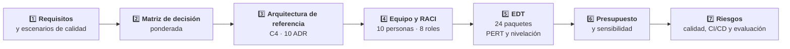

# Entrega 3 — Borrador Final

### *Desarrollo de la solución, resultados de la prueba de concepto y conclusiones del trabajo*

**Veriagent eInvoice LATAM · Trabajo de Fin de Grado · Ingeniería Informática · UNIR**

**[Entrega 1](../entrega-1-borrador-inicial/) • [Entrega 2](../entrega-2-borrador-intermedio/) • [Repositorio](../README.md) • [Desarrollo](#desarrollo-de-la-solución) • [Resultados](#resultados-obtenidos) • [Conclusiones](#conclusiones)**

---

## Tabla de Contenidos

- [Propósito de la Entrega](#propósito-de-la-entrega)
- [Archivos de esta Carpeta](#archivos-de-esta-carpeta)
- [Novedades frente a la Entrega 2](#novedades-frente-a-la-entrega-2)
- [Estructura del Documento](#estructura-del-documento)
- [Desarrollo de la Solución](#desarrollo-de-la-solución)
- [Resultados Obtenidos](#resultados-obtenidos)
- [Conclusiones](#conclusiones)
- [Referencias](#referencias)
- [Confidencialidad](#confidencialidad)
- [Autor](#autor)

---

## Propósito de la Entrega

La **Entrega 3** responde a la pregunta **qué se diseñó, qué se obtuvo y qué se concluye**. Es **acumulativa**: conserva los capítulos 1 a 3 de las entregas anteriores y completa el trabajo con el **capítulo 4, Desarrollo de la solución**, el **capítulo 5, Resultados obtenidos**, el **capítulo 6, Conclusiones** y los **anexos**.

> **Desarrollo:** arquitectura de referencia en dos planos, kit de verificación determinista, diez decisiones arquitectónicas y plan de ejecución completo.
> **Resultados:** prueba de concepto evaluada con un banco de 22 defectos inyectados y planificación simulada con Monte Carlo.
> **Conclusiones:** respuesta a la pregunta guía, discusión de los objetivos, contribuciones, implicaciones para la práctica, limitaciones y trabajo futuro.

### ¿Qué deja establecido esta entrega?

- **Una arquitectura justificada**: matriz de decisión ponderada, modelo C4 en tres niveles y **diez decisiones arquitectónicas (ADR)**.
- **Un plan ejecutable**: equipo de **diez personas en ocho roles**, matriz RACI, EDT de **24 paquetes de trabajo**, cronograma nivelado por recursos, presupuesto y registro de riesgos.
- **Una evidencia medible**: el kit detecta el **86 %** de los defectos en ejecución y el **100 %** con integración continua, **sin falsos positivos**, frente al **23 %** de la validación de esquema.
- **Un plazo y un costo con su probabilidad**: **42,2 semanas** y **COP 1.059 millones** con una confianza del **80 %**.
- **Un umbral de rentabilidad**: punto de equilibrio en **2,9 países** para los agentes y en **5,4** para la inversión completa.

---

## Archivos de esta Carpeta

<table align="center">
  <tr><th>Archivo</th><th>Descripción</th></tr>
  <tr><td><code>TFG_Entrega3_DeMendozaTovar.pdf</code></td><td><b>Versión de lectura</b> de la Entrega 3 (75 páginas)</td></tr>
  <tr><td><code>TFG_Entrega3_DeMendozaTovar.docx</code></td><td><b>Versión editable</b> en Word, con índices de contenidos, figuras y tablas</td></tr>
  <tr><td><code>README.md</code></td><td>Este documento: resumen de lo que contiene la entrega</td></tr>
</table>

---

## Novedades frente a la Entrega 2

| Elemento | Entrega 2 | Entrega 3 |
|:---|:---:|:---:|
| **Capítulo 4 · Desarrollo de la solución** | Iniciado | **11 apartados completos** |
| **Capítulo 5 · Resultados obtenidos** | Pendiente | **8 apartados completos** |
| **Capítulo 6 · Conclusiones** | Pendiente | **7 apartados completos** |
| **Anexos** | Pendiente | **A**, decisiones arquitectónicas completas · **B**, supuestos de planificación · **C**, resultados detallados del banco de defectos |
| **Figuras** | 5 | **18** |
| **Tablas** | 8 | **35** |
| **Referencias** | 53 | **59** · 6 nuevas sobre referentes salariales del mercado colombiano y la escala de madurez tecnológica (TRL) |
| **Páginas** | 37 | **75** |
| **Capítulos 1 a 3** | Completos | Se conservan |

---

## Estructura del Documento

| Capítulo / Apartado | Contenido | Pág. | Estado |
|:---|:---|:---:|:---:|
| **1. Introducción** | Problema, justificación, objetivos y elementos innovadores | 10 | Completo |
| **2. Situación de partida** | Organización de referencia, puntos de dolor, taxonomía y análisis | 17 | Completo |
| **3. Metodología** | Enfoque, diagnóstico, decisión, diseño, validación, planificación y trazabilidad | 25 | Completo |
| **4. Desarrollo de la solución** | **Completado en esta entrega** | **32** | Completo |
| &nbsp;&nbsp;4.1 Aportación | Taxonomía de defectos y kit de verificación | 32 | |
| &nbsp;&nbsp;4.2 Requisitos y atributos de calidad | Requisitos funcionales, escenarios de calidad y restricciones | 33 | |
| &nbsp;&nbsp;4.3 Selección de la alternativa | Matriz de decisión ponderada y análisis de sensibilidad | 34 | |
| &nbsp;&nbsp;4.4 Arquitectura de referencia | Contexto, contenedores, stack, contratos, datos y seguridad | 35 | |
| &nbsp;&nbsp;4.5 Decisiones arquitectónicas | Diez ADR y ciclo gobernado de una propuesta de IA | 39 | |
| &nbsp;&nbsp;4.6 Perfiles de trabajo | Equipo del proyecto y matriz RACI | 40 | |
| &nbsp;&nbsp;4.7 Planificación | Fases e hitos, EDT con estimaciones de tres puntos, nivelación y cronograma | 41 | |
| &nbsp;&nbsp;4.8 Presupuesto | Partidas, consumo de LLM, referentes salariales y sensibilidad | 44 | |
| &nbsp;&nbsp;4.9 Análisis de riesgos | Registro de riesgos con funciones del NIST AI RMF | 46 | |
| &nbsp;&nbsp;4.10 Calidad, CI/CD y gobierno | Plan de pruebas, pipeline de Jenkins y gobierno del proyecto | 47 | |
| &nbsp;&nbsp;4.11 Evaluación de la solución | Indicadores, momento de medición, responsable y criterio de éxito | 48 | |
| **5. Resultados obtenidos** | **Nuevo en esta entrega** | **50** | Completo |
| &nbsp;&nbsp;5.1 Prueba de concepto | Alcance, implementación y pruebas automatizadas | 50 | |
| &nbsp;&nbsp;5.2 Banco de defectos por inyección | 22 mutantes sobre 300 comprobantes sintéticos | 51 | |
| &nbsp;&nbsp;5.3 Agente de mapeo y ciclo gobernado | Propuesta, bloqueo por el kit y corrección | 53 | |
| &nbsp;&nbsp;5.4 Consolas de revisión | Consola web y consola de escritorio JavaFX | 53 | |
| &nbsp;&nbsp;5.5 Pipeline y madurez | Ejecución del pipeline y nivel de madurez tecnológica | 55 | |
| &nbsp;&nbsp;5.6 Resultados de la planificación | Monte Carlo, criticidad y punto de equilibrio | 55 | |
| &nbsp;&nbsp;5.7 Amenazas a la validez | Límites de la evidencia obtenida | 57 | |
| &nbsp;&nbsp;5.8 Cumplimiento de los objetivos | Evidencia y estado por objetivo | 58 | |
| **6. Conclusiones** | **Nuevo en esta entrega** | **59** | Completo |
| **Referencias bibliográficas** | 59 referencias en formato APA | 64 | Completo |
| **Anexos** | Anexo A (69), Anexo B (74) y Anexo C (75) | 69 | Completo |

<b>Figuras de la entrega</b>

| Elemento | Título | Pág. |
|:---|:---|:---:|
| Figura 1 | Arquitectura propuesta: flujos de integración, kit de verificación y plano agéntico | 13 |
| Figura 2 | Arquitectura actual de integración: flujos asíncrono y síncrono | 18 |
| Figura 3 | Flujos actuales de emisión asíncrona y síncrona, estados del comprobante y origen de los defectos | 19 |
| Figura 4 | Fases de la metodología, objetivos y entregables | 25 |
| Figura 5 | Diagrama Ishikawa rechazo de comprobantes por defectos de mapeo | 27 |
| Figura 6 | Componentes del kit de verificación (C4, nivel 3) | 33 |
| Figura 7 | Diagrama de contexto (C4, nivel 1) | 35 |
| Figura 8 | Diagrama de contenedores (C4, nivel 2) | 36 |
| Figura 9 | Secuencia del ciclo gobernado de una propuesta de IA | 40 |
| Figura 10 | Carga semanal por rol tras la nivelación | 43 |
| Figura 11 | Cronograma nivelado con ruta crítica, P50 y P80 | 44 |
| Figura 12 | Presupuesto por partida | 45 |
| Figura 13 | Detección de defectos por tipo y mecanismo | 52 |
| Figura 14 | Consola web de revisión con una propuesta bloqueada por el kit | 54 |
| Figura 15 | Consola de escritorio JavaFX con una propuesta pendiente de revisión | 54 |
| Figura 16 | Distribución del plazo total: plan base y escenario con dos personas de QA | 56 |
| Figura 17 | Índice de criticidad de los paquetes de trabajo | 56 |
| Figura 18 | Punto de equilibrio en esfuerzo acumulado | 57 |

<b>Tablas de la entrega</b>

| Elemento | Título | Pág. |
|:---|:---|:---:|
| Tabla 1 | Análisis de Pareto de los defectos de mapeo del caso de referencia | 12 |
| Tabla 2 | Puntos de dolor del proceso actual | 20 |
| Tabla 3 | Taxonomía de defectos de mapeo | 20 |
| Tabla 4 | Cobertura de las necesidades del problema por enfoque | 24 |
| Tabla 5 | Protocolo de búsqueda de la literatura | 26 |
| Tabla 6 | Métricas de evaluación derivadas con el enfoque GQM | 29 |
| Tabla 7 | Trazabilidad entre objetivos, fases, métodos y entregables | 30 |
| Tabla 8 | Requisitos funcionales | 33 |
| Tabla 9 | Escenarios de atributos de calidad | 34 |
| Tabla 10 | Matriz de decisión ponderada | 34 |
| Tabla 11 | Microservicios del plano de integración | 36 |
| Tabla 12 | Componentes del plano agéntico | 37 |
| Tabla 13 | Lenguajes y su justificación | 37 |
| Tabla 14 | Frameworks, librerías e infraestructura | 37 |
| Tabla 15 | Tablas del núcleo del modelo de datos | 38 |
| Tabla 16 | Resumen de las decisiones arquitectónicas | 39 |
| Tabla 17 | Equipo del proyecto | 40 |
| Tabla 18 | Matriz RACI | 40 |
| Tabla 19 | Fases e hitos de control del proyecto | 41 |
| Tabla 20 | Estructura de desglose del trabajo con estimaciones de tres puntos | 42 |
| Tabla 21 | Presupuesto por partida (millones de COP) | 44 |
| Tabla 22 | Consumo estimado de LLM por agente | 45 |
| Tabla 23 | Salario base implícito por rol y referentes públicos del mercado colombiano | 46 |
| Tabla 24 | Sensibilidad del costo del proyecto a las tarifas por rol | 46 |
| Tabla 25 | Registro de riesgos | 47 |
| Tabla 26 | Etapas del pipeline de Jenkins | 48 |
| Tabla 27 | Plan de evaluación de la solución | 48 |
| Tabla 28 | Componentes implementados en la prueba de concepto | 50 |
| Tabla 29 | Suites de pruebas y resultados | 51 |
| Tabla 30 | Mutantes detectados por tipo y mecanismo | 51 |
| Tabla 31 | Resultados de la simulación de Monte Carlo | 55 |
| Tabla 32 | Cumplimiento de los objetivos específicos y del objetivo general | 58 |
| Tabla 33 | Costo empresa mensual por rol (supuesto) | 74 |
| Tabla 34 | Otros supuestos del modelo | 74 |
| Tabla 35 | Resultado por mutante | 75 |

---

## Desarrollo de la Solución

La aportación central es un **kit de verificación determinista** construido sobre la taxonomía D1–D6, que une los dos planos de la arquitectura: el **plano de integración**, orientado a eventos, y el **plano agéntico**, donde los agentes proponen mapeos, plantillas y pruebas. El kit actúa como gate antes de la revisión humana y en ejecución dentro de los adaptadores.

| Apartado | Qué aporta |
|:---:|:---|
| 1️⃣ Selección de la alternativa | Cinco alternativas puntuadas en seis criterios ponderados, con análisis de sensibilidad sobre el punto débil de la propuesta |
| 2️⃣ Arquitectura de referencia | Diagramas de contexto, contenedores y componentes (C4), microservicios, stack tecnológico, contratos, modelo de datos y seguridad por diseño |
| 3️⃣ Decisiones arquitectónicas | Diez ADR con contexto, opciones, decisión, consecuencias y escenario de calidad; el detalle completo está en el **Anexo A** |
| 4️⃣ Perfiles y responsabilidades | Equipo del proyecto con su capacidad y matriz RACI por actividad |
| 5️⃣ Planificación | Seis fases con seis hitos de control (G0 a G5), EDT con estimaciones de tres puntos, nivelación por recursos y cronograma con ruta crítica |
| 6️⃣ Presupuesto | Cuatro partidas (personas, nube, licencias y herramientas, y consumo de LLM), con tarifas calibradas con referentes salariales públicos; el LLM representa **menos del 0,2 %** del presupuesto |
| 7️⃣ Riesgos, calidad y CI/CD | Registro de riesgos con funciones del NIST AI RMF, plan de pruebas y pipeline de Jenkins con el kit como gate |

---

## Resultados Obtenidos

La prueba de concepto se construyó sobre **una especificación y datos sintéticos**. El banco aplica **22 mutantes** de los seis tipos sobre **300 comprobantes sintéticos y 12 ejemplos validados**, en total **14.688 verificaciones**.

| Mecanismo de verificación | Defectos detectados | Tasa de detección | Falsos positivos |
|:---|:---:|:---:|:---:|
| Solo validación de esquema | 5 de 22 | 23 % | 0 |
| Kit en ejecución | 19 de 22 | **86 %** | 0 |
| Kit con ejemplos validados en integración continua | 22 de 22 | **100 %** | 0 |

- Los falsos positivos se midieron sobre **1.224 verificaciones** de salidas correctas: cero en los tres mecanismos.
- El **agente de mapeo** propuso **23 de 24 campos** correctos (95,8 %); su único error quedó bloqueado por el kit antes de la revisión humana.
- El kit de verificación queda en **TRL 4**, validado en laboratorio con datos sintéticos y un banco de defectos.

| Indicador (Monte Carlo) | P10 | P50 | P80 | P90 |
|:---|:---:|:---:|:---:|:---:|
| Duración (semanas) | 37,3 | 40,2 | **42,2** | 43,3 |
| Duración (meses) | 8,6 | 9,3 | **9,7** | 10,0 |
| Costo (millones de COP) | 947 | 1.013 | **1.059** | 1.085 |

- Con una **segunda persona de QA**, el P50 baja de 40,2 a 38,1 semanas y el costo P50 de COP 1.013 a 982 millones.
- El **punto de equilibrio** está en **2,9 países** para los agentes y en **5,4** para la inversión completa.

---

## Conclusiones

| Apartado | Contenido |
|:---|:---|
| **6.1 Síntesis del trabajo** | El problema de partida y la solución planificada |
| **6.2 Respuesta a la pregunta guía** | Respuesta a las tres subpreguntas de investigación |
| **6.3 Discusión de los objetivos** | Cumplimiento de OE1, OE2 y OE3 y su dependencia en cadena |
| **6.4 Contribuciones del trabajo** | Las cinco contribuciones anunciadas como elementos innovadores |
| **6.5 Implicaciones para la práctica** | Tratar la salida de un modelo de lenguaje como una propuesta sujeta a verificación objetiva |
| **6.6 Limitaciones** | Datos sintéticos, motor heurístico como línea base, ahorro por país como hipótesis y tarifas estimadas |
| **6.7 Líneas de trabajo futuro** | Medición con un modelo real, ampliación del banco, validación con expertos y modelo semántico común |

> La inteligencia artificial generativa puede aplicarse en un dominio regulado como la facturación electrónica si su salida se trata como una propuesta sujeta a verificación objetiva, trazabilidad hasta la norma y aprobación humana, y no como una decisión automática.

---

## Referencias

La entrega se apoya en **59 referencias** en formato APA. Las **6 nuevas** respecto a la Entrega 2 sustentan los referentes salariales del mercado colombiano y la escala de madurez tecnológica (TRL):

<b>Ver las 6 referencias nuevas</b>

| Ámbito | Referencia |
|:---|:---|
| Presupuesto | Buk (2026). *Costo real de un empleado en Colombia 2026*. |
| Presupuesto | Colombia Move (2026). *Salarios en Colombia por industria: rangos reales 2026* [Entrada de blog]. |
| Presupuesto | La FM (2024). *Las profesiones mejor pagadas: se gana hasta $26 millones al mes*. |
| Presupuesto | Portafolio (2026). *Salarios en tecnología en Colombia 2026: cuánto ganan perfiles en inteligencia artificial, datos y software*. |
| Presupuesto | Valora Analitik (2026). *Estos trabajos en Colombia están pagando hasta $23 millones mensuales*. |
| Madurez tecnológica | Comisión Europea (2014). *Horizon 2020 – Work Programme 2014-2015: General annexes. G. Technology readiness levels (TRL)*. |

La lista completa está en el capítulo **Referencias Bibliográficas** del documento.

---

## Confidencialidad

- El caso de referencia está **anonimizado**: no se identifica ninguna organización, proveedor ni sistema real.
- Los pesos del análisis de Pareto y las tarifas por rol son **estimaciones del autor**, declaradas como tales.
- La prueba de concepto se construye sobre **una especificación y datos sintéticos**; no usa información de ninguna organización ni datos tributarios reales.

---

## Autor

Entrega desarrollada como parte del **Trabajo de Fin de Grado** del programa de **Ingeniería Informática** de la **Fundación Universitaria Internacional de La Rioja (UNIR)**, sede Colombia (Bogotá D. C.), bajo la dirección de **Johan Sebastián Giraldo Hurtado**.

 

### Alejandro De Mendoza Tovar

**Ingeniero Senior de Integraciones y Plataformas · Desarrollador Backend y Full Stack**

| Autor | Perfil |
|:---:|:---:|
| ***Alejandro De Mendoza Tovar*** |  |

---

### *La IA propone, la norma verifica y las personas deciden*

**[Entrega 1](../entrega-1-borrador-inicial/) · [Entrega 2](../entrega-2-borrador-intermedio/) · [Volver al repositorio](../README.md)**

**Entrega 3 · Borrador final · Veriagent eInvoice LATAM · UNIR · 2026**

