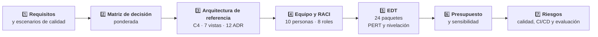

# Entrega 3 — Borrador Final

### *Desarrollo de la solución, resultados del prototipo y conclusiones del trabajo, con las observaciones del director atendidas*

**Veriagent eInvoice LATAM · Trabajo de Fin de Grado · Ingeniería Informática · UNIR**

[%20%C2%B7%2093%2C8%20%25%20(129)-150458.svg)]()

**[Entrega 1](../entrega-1-borrador-inicial/) • [Entrega 2](../entrega-2-borrador-intermedio/) • [Prototipo](../prototipo/README.md) • [Repositorio](../README.md) • [Desarrollo](#desarrollo-de-la-solución) • [Resultados](#resultados-obtenidos) • [Conclusiones](#conclusiones)**

---

## Tabla de Contenidos

- [Propósito de la Entrega](#propósito-de-la-entrega)
- [Estado de esta Carpeta](#estado-de-esta-carpeta)
- [Archivos de esta Carpeta](#archivos-de-esta-carpeta)
- [Novedades frente a la Entrega 2 corregida](#novedades-frente-a-la-entrega-2-corregida)
- [Estructura del Documento](#estructura-del-documento)
- [Desarrollo de la Solución](#desarrollo-de-la-solución)
- [Resultados Obtenidos](#resultados-obtenidos)
- [Conclusiones](#conclusiones)
- [Referencias](#referencias)
- [Confidencialidad](#confidencialidad)
- [Autor](#autor)

---

## Propósito de la Entrega

La **Entrega 3** responde a la pregunta **qué se diseñó, qué se obtuvo y qué se concluye**. Es **acumulativa**: parte de la [**Entrega 2 corregida**](../entrega-2-borrador-intermedio/), que ya atiende las observaciones del director e incluye la revisión sistemática, los anexos A a E y los resultados del prototipo, y la completa con el **cumplimiento de los objetivos (apartado 5.8)** y el **capítulo 6, Conclusiones**.

> **Desarrollo:** arquitectura de referencia en dos planos, kit de verificación determinista, siete vistas, agentes con permisos mínimos, revisión humana, modelo de amenazas, doce decisiones arquitectónicas y plan de ejecución completo.
> **Resultados:** prototipo evaluado con un banco original de 22 defectos inyectados y un banco ampliado de 129 mutantes, ejecutado por el sistema real, y planificación simulada con Monte Carlo.
> **Conclusiones:** respuesta a la pregunta guía y a sus tres subpreguntas, discusión de los objetivos, contribuciones, implicaciones para la práctica, limitaciones y trabajo futuro.

### ¿Qué deja establecido esta entrega?

- **Una arquitectura justificada**: matriz de decisión ponderada, modelo C4, siete vistas y **doce decisiones arquitectónicas (ADR)**.
- **Un plan ejecutable**: equipo de **diez personas en ocho roles**, matriz RACI, EDT de **24 paquetes de trabajo**, cronograma nivelado por recursos, presupuesto y registro de riesgos.
- **Una evidencia medible sobre datos sintéticos**: el kit detecta en ejecución el **86,4 %** del banco original (19 de 22) y el **93,8 %** del banco ampliado (121 de 129), el **100 %** con ejemplos validados, y **0 falsos positivos en 11.402 comprobantes correctos**.
- **Un plazo y un costo con su probabilidad**: **42,2 semanas** y **COP 1.059 millones** con una confianza del **80 %**.
- **Una hipótesis con protocolo**: punto de equilibrio de **2,9 países** para los agentes y **5,4** para la inversión completa, si el esfuerzo asistido es menor que el manual (se comprueba en la fase F5).

---

## Estado de esta Carpeta

> Esta carpeta contiene la **versión final del borrador (24 de octubre de 2026)**. Se construyó sobre la [**Entrega 2 corregida**](../entrega-2-borrador-intermedio/), con las observaciones del director atendidas, y añade el apartado **5.8, Cumplimiento de los objetivos**, el **capítulo 6, Conclusiones**, y la última oración del resumen y del abstract. El resto del texto es idéntico al de la Entrega 2 corregida. Sustituye al borrador del 18 de octubre (75 páginas).

| Carpeta | Contenido |
|:---|:---|
| [Entrega 1](../entrega-1-borrador-inicial/) | Problema, objetivos y situación de partida |
| [Entrega 2 corregida](../entrega-2-borrador-intermedio/) | Versión corregida con las observaciones del director |
| [Prototipo](../prototipo/README.md) | Código, escenarios y resultados medidos |

---

## Archivos de esta Carpeta

<table align="center">
  <tr><th>Archivo</th><th>Descripción</th></tr>
  <tr><td><code>TFG_Entrega3_DeMendozaTovar_Final_1.pdf</code></td><td><b>Versión de lectura</b> de la Entrega 3 (128 páginas)</td></tr>
  <tr><td><code>TFG_Entrega3_DeMendozaTovar_Final_1.docx</code></td><td><b>Versión editable</b> en Word, con índices de contenidos, figuras y tablas</td></tr>
  <tr><td><code>README.md</code></td><td>Este documento: resumen de lo que contiene la entrega</td></tr>
</table>

---

## Novedades frente a la Entrega 2 corregida

| Elemento | Entrega 2 corregida | Entrega 3 |
|:---|:---:|:---:|
| **Capítulo 5 · Resultados obtenidos** | 7 apartados | **8 apartados**: se restaura el 5.8, Cumplimiento de los objetivos |
| **Capítulo 6 · Conclusiones** | En desarrollo | **7 apartados completos** |
| **Resumen y abstract** | Sin oración de conclusiones | **Con la oración final sobre las conclusiones** |
| **Anexos** | A a E | A a E |
| **Figuras** | 24 | **24** |
| **Tablas** | 58 | **59** |
| **Referencias** | 105 | **105** |
| **Páginas** | 119 | **128** |
| **Capítulos 1 a 4** | Completos | Se conservan |

---

## Estructura del Documento

El cuerpo, de la Introducción al final de las Referencias, ocupa las páginas 15 a 108.

| Capítulo / Apartado | Contenido | Pág. | Estado |
|:---|:---|:---:|:---:|
| **1. Introducción** | Problema, justificación, objetivos, pregunta guía y elementos innovadores | 15 | Completo |
| **2. Descripción de la situación de partida y planteamiento del problema** | Organización de referencia, puntos de dolor, taxonomía D1 a D6 y revisión sistemática asistida y parcial (PRISMA 2020) | 23 | Completo |
| **3. Metodología** | Enfoque DSRM, revisión de la literatura, diagnóstico, decisión, diseño, validación, planificación y protocolo de evaluación | 36 | Completo |
| **4. Desarrollo de la solución** | Kit de verificación, arquitectura de referencia con vistas, agentes, revisión humana y amenazas, 12 ADR y plan del proyecto | 48 | Completo |
| &nbsp;&nbsp;4.1 Aportación: taxonomía de defectos y kit de verificación | Taxonomía D1 a D6 y kit de verificación | 48 | |
| &nbsp;&nbsp;4.2 Requisitos y atributos de calidad | Requisitos funcionales, escenarios de calidad y restricciones | 51 | |
| &nbsp;&nbsp;4.3 Selección de la alternativa de solución | Matriz de decisión ponderada | 52 | |
| &nbsp;&nbsp;4.4 Arquitectura de referencia | C4, stack, contratos, datos, seguridad, siete vistas, agentes y permisos, revisión humana, amenazas e integridad | 52 | |
| &nbsp;&nbsp;4.5 Decisiones arquitectónicas | Doce ADR | 64 | |
| &nbsp;&nbsp;4.6 Perfiles de trabajo y matriz de responsabilidades | Equipo y matriz RACI | 66 | |
| &nbsp;&nbsp;4.7 Planificación de tareas, esfuerzos y cronograma | Fases, EDT de 24 paquetes, nivelación y cronograma | 66 | |
| &nbsp;&nbsp;4.8 Presupuesto | Partidas, consumo de LLM y referentes salariales | 71 | |
| &nbsp;&nbsp;4.9 Análisis de riesgos | Registro de riesgos con funciones del NIST AI RMF | 74 | |
| &nbsp;&nbsp;4.10 Plan de calidad, integración y despliegue continuos y gobierno del proyecto | Plan de pruebas, pipeline de Jenkins y gobierno | 75 | |
| &nbsp;&nbsp;4.11 Evaluación de la solución | Indicadores y criterio de éxito | 76 | |
| **5. Resultados obtenidos** | Prototipo, bancos de defectos, agente de mapeo, consolas, pipeline, planificación, amenazas a la validez y cumplimiento | 78 | Completo |
| &nbsp;&nbsp;5.1 Prueba de concepto: alcance, implementación y pruebas | Alcance, implementación y pruebas automatizadas | 78 | |
| &nbsp;&nbsp;5.2 Banco de defectos por inyección | Banco original de 22 mutantes y banco ampliado de 129 | 79 | |
| &nbsp;&nbsp;5.3 Agente de mapeo y ciclo gobernado | Propuesta, bloqueo por el kit y corrección | 83 | |
| &nbsp;&nbsp;5.4 Consolas de revisión | Consola web y consola JavaFX | 83 | |
| &nbsp;&nbsp;5.5 Pipeline, despliegue y madurez alcanzada | Pipeline y nivel de madurez tecnológica | 85 | |
| &nbsp;&nbsp;5.6 Resultados de la planificación | Monte Carlo, criticidad y punto de equilibrio | 86 | |
| &nbsp;&nbsp;5.7 Amenazas a la validez | Límites de la evidencia | 89 | |
| &nbsp;&nbsp;5.8 Cumplimiento de los objetivos | **Restaurado:** resultado y naturaleza de la evidencia por objetivo | 89 | |
| **6. Conclusiones** | Síntesis, respuesta a la pregunta guía, objetivos, contribuciones, implicaciones, limitaciones y trabajo futuro | 91 | Completo |
| &nbsp;&nbsp;6.1 Síntesis del trabajo |  | 91 | |
| &nbsp;&nbsp;6.2 Respuesta a la pregunta guía |  | 91 | |
| &nbsp;&nbsp;6.3 Discusión de los objetivos |  | 93 | |
| &nbsp;&nbsp;6.4 Contribuciones del trabajo |  | 94 | |
| &nbsp;&nbsp;6.5 Implicaciones para la práctica |  | 94 | |
| &nbsp;&nbsp;6.6 Limitaciones |  | 95 | |
| &nbsp;&nbsp;6.7 Líneas de trabajo futuro |  | 96 | |
| **Referencias bibliográficas** | 105 referencias en formato APA | 98 | Completo |
| **Anexos** | Anexo A (109), Anexo B (115), Anexo C (116), Anexo D (117), Anexo E (124) | 109 | Completo |

<b>Figuras de la entrega</b>

| Elemento | Título | Pág. |
|:---|:---|:---:|
| Figura 1 | Arquitectura propuesta: flujos de integración, kit de verificación y plano agéntico | 18 |
| Figura 2 | Arquitectura actual de integración: flujos asíncrono y síncrono | 24 |
| Figura 3 | Flujos actuales de emisión asíncrona y síncrona, estados del comprobante y origen de los defectos | 25 |
| Figura 4 | Diagrama de flujo de la revisión sistemática asistida y parcial (PRISMA 2020) | 32 |
| Figura 5 | Fases de la metodología, objetivos y entregables | 36 |
| Figura 6 | Diagrama Ishikawa rechazo de comprobantes por defectos de mapeo | 40 |
| Figura 7 | Componentes del kit de verificación (C4, nivel 3) | 49 |
| Figura 8 | Diagrama de contexto (C4, nivel 1) | 53 |
| Figura 9 | Diagrama de contenedores (C4, nivel 2) | 53 |
| Figura 10 | Secuencia del ciclo gobernado de una propuesta de IA | 65 |
| Figura 11 | Carga semanal por rol tras la nivelación | 69 |
| Figura 12 | Cronograma nivelado con ruta crítica, P50 y P80 | 70 |
| Figura 13 | Presupuesto por partida | 72 |
| Figura 14 | Detección de defectos por tipo y mecanismo | 80 |
| Figura 15 | Consola web de revisión con una propuesta bloqueada por el kit | 84 |
| Figura 16 | Consola de escritorio JavaFX con una propuesta pendiente de revisión | 85 |
| Figura 17 | Distribución del plazo total: plan base y escenario con dos personas de QA | 86 |
| Figura 18 | Índice de criticidad de los paquetes de trabajo | 87 |
| Figura 19 | Punto de equilibrio en esfuerzo acumulado | 88 |
| Figura 20 | Búsqueda S1 con los filtros de tipo de documento e idioma: 1007 documentos | 125 |
| Figura 21 | Búsqueda S2 con los filtros aplicados: 768 documentos | 126 |
| Figura 22 | Búsqueda S3 con los filtros aplicados: 3945 documentos | 127 |
| Figura 23 | Búsqueda S4 con los filtros aplicados: 86 documentos | 128 |
| Figura 24 | Búsquedas guardadas S1 a S4 con su número de resultados | 128 |

<b>Tablas de la entrega</b>

| Elemento | Título | Pág. |
|:---|:---|:---:|
| Tabla 1 | Análisis de Pareto de los defectos de mapeo del caso de referencia | 17 |
| Tabla 2 | Puntos de dolor del proceso actual | 26 |
| Tabla 3 | Taxonomía de defectos de mapeo | 26 |
| Tabla 4 | Cobertura de las necesidades del problema por enfoque | 30 |
| Tabla 5 | Flujo de registros de la revisión sistemática asistida y parcial (PRISMA 2020) | 31 |
| Tabla 6 | Resultado del cribado por título y resumen por búsqueda y tema | 33 |
| Tabla 7 | Cruce de brecha sobre los 5659 registros únicos con tres diccionarios | 33 |
| Tabla 8 | Concordancia entre la regla y la verificación del autor (muestra de 60 registros) | 34 |
| Tabla 9 | Actividades del DSRM, fases, técnicas y apartados | 37 |
| Tabla 10 | Estrategia de búsqueda ejecutada en Scopus el 20 de octubre de 2026 | 38 |
| Tabla 11 | Métricas de evaluación derivadas con el enfoque GQM | 42 |
| Tabla 12 | Trazabilidad entre objetivos, fases, métodos y entregables | 43 |
| Tabla 13 | Definiciones de la evaluación del verificador | 45 |
| Tabla 14 | Definición formal de la taxonomía D1 a D6 | 49 |
| Tabla 15 | Requisitos funcionales | 51 |
| Tabla 16 | Escenarios de atributos de calidad | 51 |
| Tabla 17 | Matriz de decisión ponderada | 52 |
| Tabla 18 | Microservicios del plano de integración | 53 |
| Tabla 19 | Componentes del plano agéntico | 54 |
| Tabla 20 | Lenguajes y su justificación | 54 |
| Tabla 21 | Frameworks, librerías e infraestructura | 55 |
| Tabla 22 | Tablas del núcleo del modelo de datos | 56 |
| Tabla 23 | Vistas de la arquitectura | 57 |
| Tabla 24 | Despliegue del prototipo según el chart de Helm (commit 0b6406c) | 58 |
| Tabla 25 | Agentes y responsabilidades | 58 |
| Tabla 26 | Permisos mínimos de cada agente sobre las herramientas | 59 |
| Tabla 27 | Estados de una propuesta y transiciones | 59 |
| Tabla 28 | Modelo de amenazas y controles | 62 |
| Tabla 29 | Controles de integridad de la normativa y de las reglas | 64 |
| Tabla 30 | Resumen de las decisiones arquitectónicas | 64 |
| Tabla 31 | Equipo del proyecto | 66 |
| Tabla 32 | Matriz RACI | 66 |
| Tabla 33 | Fases e hitos de control del proyecto | 67 |
| Tabla 34 | Estructura de desglose del trabajo con estimaciones de tres puntos | 67 |
| Tabla 35 | Razones o/m y p/m de las estimaciones por grupo de paquetes | 70 |
| Tabla 36 | Convergencia de la simulación con tres semillas | 71 |
| Tabla 37 | Presupuesto por partida (millones de COP) | 72 |
| Tabla 38 | Consumo estimado de LLM por agente | 72 |
| Tabla 39 | Salario base implícito por rol y referentes públicos del mercado colombiano | 73 |
| Tabla 40 | Sensibilidad del costo del proyecto a las tarifas por rol | 74 |
| Tabla 41 | Registro de riesgos | 74 |
| Tabla 42 | Etapas del pipeline de Jenkins | 75 |
| Tabla 43 | Plan de evaluación de la solución | 77 |
| Tabla 44 | Naturaleza de los resultados | 78 |
| Tabla 45 | Componentes implementados en la prueba de concepto | 79 |
| Tabla 46 | Suites de pruebas y resultados | 79 |
| Tabla 47 | Mutantes detectados por tipo y mecanismo | 80 |
| Tabla 48 | Intervalos de confianza de la detección y de los falsos positivos | 81 |
| Tabla 49 | Banco ampliado: detección por tipo con su intervalo de confianza del 95 % (Wilson) | 82 |
| Tabla 50 | Resultados de la simulación de Monte Carlo | 86 |
| Tabla 51 | Supuestos del punto de equilibrio | 88 |
| Tabla 52 | Sensibilidad del punto de equilibrio al esfuerzo asistido | 89 |
| Tabla 53 | Cumplimiento de los objetivos y naturaleza de la evidencia | 89 |
| Tabla 54 | Costo empresa mensual por rol (supuesto) | 116 |
| Tabla 55 | Otros supuestos del modelo | 116 |
| Tabla 56 | Resultado por mutante | 116 |
| Tabla 57 | Matriz del estado del arte: selección dirigida de 40 estudios | 117 |
| Tabla 58 | Resumen de la verificación de las referencias | 123 |
| Tabla 59 | Referencias dudosas, pendientes de verificación del autor | 124 |

---

## Desarrollo de la Solución

La aportación central es un **kit de verificación determinista** construido sobre la taxonomía D1–D6, que une los dos planos de la arquitectura: el **plano de integración**, orientado a eventos, y el **plano agéntico**, donde los agentes proponen mapeos, plantillas y pruebas. El kit actúa como gate antes de la revisión humana y en ejecución dentro de los adaptadores.

| Apartado | Qué aporta |
|:---:|:---|
| 1️⃣ Selección de la alternativa | Alternativas puntuadas con criterios ponderados y análisis de sensibilidad |
| 2️⃣ Arquitectura de referencia | C4, stack, contratos, modelo de datos, seguridad por diseño, **siete vistas**, agentes y permisos, revisión humana, **modelo de amenazas** e integridad de la normativa |
| 3️⃣ Decisiones arquitectónicas | **Doce ADR** con contexto, opciones, decisión, consecuencias y escenario de calidad; el detalle completo está en el **Anexo A** |
| 4️⃣ Perfiles y responsabilidades | Equipo del proyecto con su capacidad y matriz RACI por actividad |
| 5️⃣ Planificación | Seis fases con seis hitos de control (G0 a G5), EDT con estimaciones de tres puntos, nivelación por recursos y cronograma con ruta crítica |
| 6️⃣ Presupuesto | Personas, nube, licencias y herramientas, y consumo de LLM, con tarifas calibradas con referentes salariales públicos |
| 7️⃣ Riesgos, calidad y CI/CD | Registro de riesgos con funciones del NIST AI RMF, plan de pruebas y pipeline de Jenkins con el kit como gate |

---

## Resultados Obtenidos

El prototipo se construyó sobre **una especificación y datos sintéticos**. Los intervalos son de Wilson al 95 %.

| Banco | Kit en ejecución | Con ejemplos validados | Falsos positivos |
|:---|:---:|:---:|:---:|
| Original (22 mutantes) | 19 de 22, **86,4 %** (66,7 % a 95,3 %) | 22 de 22, **100 %** (85,1 % a 100 %) | 0 de 600 salidas correctas |
| Ampliado (129 mutantes, por el sistema real) | 121 de 129, **93,8 %** (88,2 % a 96,8 %) | 129 de 129, **100 %** (97,1 % a 100 %) | **0 de 11.402** comprobantes correctos (cota del 0,026 %) |

- La validación de esquema sola detecta el **23 %** del banco original.
- El **agente de mapeo** heurístico propuso **23 de 24 campos** correctos (95,8 %); su único error quedó bloqueado por el kit antes de la revisión humana.
- La meta del **80 %** se cumple como estimación puntual con el banco original y **con una confianza del 95 %** con el banco ampliado, sobre datos sintéticos (apartado 5.8).

| Indicador (Monte Carlo) | P10 | P50 | P80 | P90 |
|:---|:---:|:---:|:---:|:---:|
| Duración (semanas) | 37,3 | 40,2 | **42,2** | 43,3 |
| Duración (meses) | 8,6 | 9,3 | **9,7** | 10,0 |
| Costo (millones de COP) | 947 | 1.013 | **1.059** | 1.085 |

- Con una **segunda persona de QA**, el P50 baja de 40,2 a 38,1 semanas y el costo P50 de COP 1.013 a 982 millones.
- El **punto de equilibrio** estaría en **2,9 países** para los agentes y en **5,4** para la inversión completa, bajo la hipótesis de esfuerzo asistido que el protocolo del apartado 3.9.3 comprueba en la fase F5.

---

## Conclusiones

| Apartado | Contenido |
|:---|:---|
| **6.1 Síntesis del trabajo** | El problema de partida, la revisión sistemática asistida y parcial (5.806 registros identificados, 5.659 cribados, 164 en el núcleo, matriz de 40 estudios, kappa de 0,175) y la solución planificada |
| **6.2 Respuesta a la pregunta guía** | Las dos partes de la pregunta y las tres subpreguntas actuales; la tercera, como hipótesis con protocolo (apartado 3.9.3) |
| **6.3 Discusión de los objetivos** | OE1, OE2 (diseño), objetivo general con su umbral e intervalo de confianza, y OE3; controles de seguridad probados y política de red en clúster planificada |
| **6.4 Contribuciones del trabajo** | El patrón ya existe en otros dominios regulados; la contribución es su aplicación a la facturación electrónica latinoamericana, la taxonomía D1 a D6 con operadores de mutación y el plan de implantación |
| **6.5 Implicaciones para la práctica** | Tratar la salida de un modelo de lenguaje como una propuesta sujeta a verificación objetiva |
| **6.6 Limitaciones** | Datos sintéticos; una sola base, en inglés y de 2020 a 2026; cribado asistido; sin textos completos; 26 referencias sin verificar manualmente; 8 mutantes que escapan en ejecución; esfuerzo sin medir; Helm sin clúster; Docker, Jenkins y Trivy no ejecutados; disponibilidad no evaluable |
| **6.7 Líneas de trabajo futuro** | Textos completos, búsqueda complementaria, protocolo 3.9.3 en F5, política de red en clúster, Schema Registry y arquetipo, y línea base de aprendizaje automático |

> Las conclusiones indican que la inteligencia artificial generativa puede aplicarse a la incorporación de países y proveedores de facturación electrónica si su salida se trata como una propuesta sujeta a verificación determinista, trazabilidad hasta la norma y aprobación humana, y no como una decisión automática; la reducción del esfuerzo queda como hipótesis, con un protocolo para comprobarla durante la ejecución del proyecto.

---

## Referencias

La entrega se apoya en **105 referencias** en formato APA, las mismas de la Entrega 2 corregida. Incluyen los 40 estudios de la matriz del estado del arte (anexo D), con los metadatos tomados de Scopus y 39 de 40 DOI resueltos. 26 referencias, entre ellas libros y normas sin DOI ni URL, no se han verificado manualmente contra su fuente; el anexo D detalla la verificación. La lista completa está en el capítulo **Referencias Bibliográficas** del documento.

---

## Confidencialidad

- El caso de referencia está **anonimizado**: no se identifica ninguna organización, proveedor ni sistema real.
- Los pesos del análisis de Pareto y las tarifas por rol son **estimaciones del autor**, declaradas como tales.
- El prototipo se construye sobre **una especificación y datos sintéticos**; no usa información de ninguna organización ni datos tributarios reales.

---

## Autor

Entrega desarrollada como parte del **Trabajo de Fin de Grado** del programa de **Ingeniería Informática** de la **Fundación Universitaria Internacional de La Rioja (UNIR)**, sede Colombia (Bogotá D. C.), bajo la dirección de **Johan Sebastián Giraldo Hurtado**.

 

### Alejandro De Mendoza Tovar

**Ingeniero Senior de Integraciones y Plataformas · Desarrollador Backend y Full Stack**

| Autor | Perfil |
|:---:|:---:|
| ***Alejandro De Mendoza Tovar*** |  |

---

### *La IA propone, la norma verifica y las personas deciden*

**[Entrega 1](../entrega-1-borrador-inicial/) · [Entrega 2](../entrega-2-borrador-intermedio/) · [Prototipo](../prototipo/README.md) · [Volver al repositorio](../README.md)**

**Entrega 3 · Borrador final · Veriagent eInvoice LATAM · UNIR · 2026**

