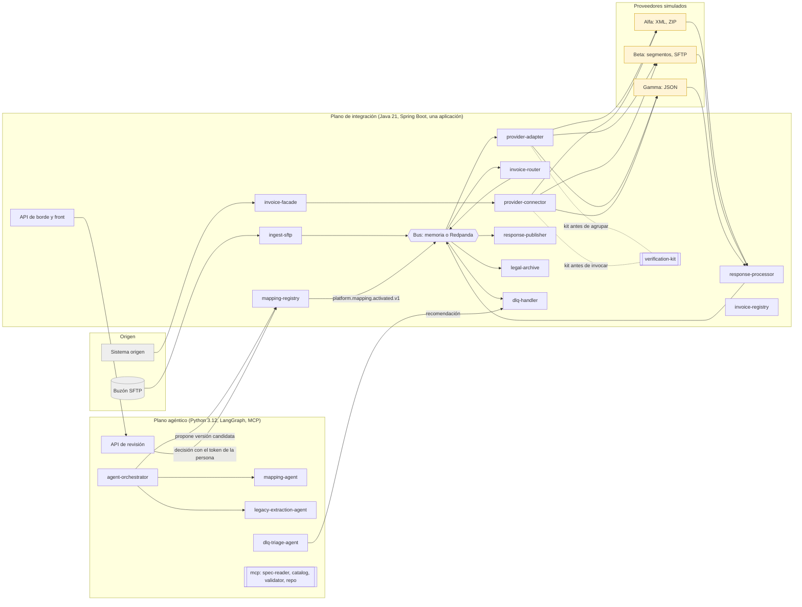
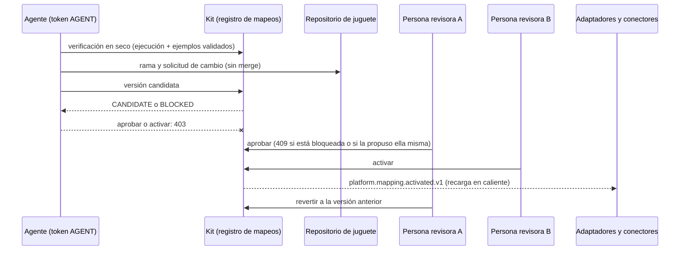
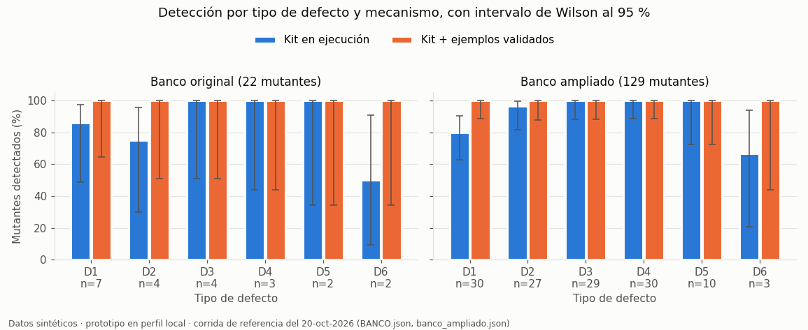
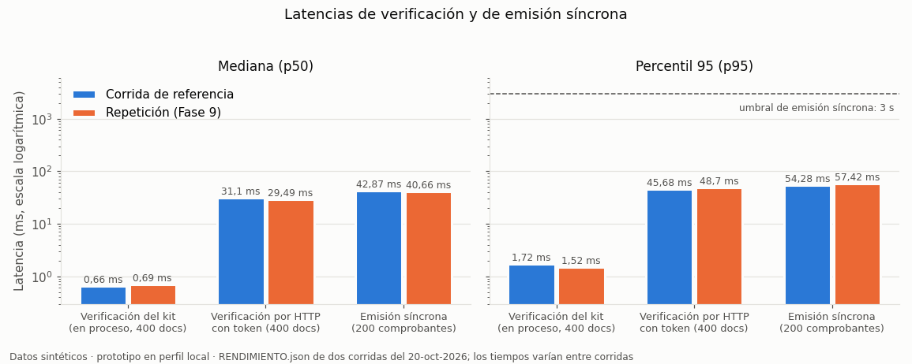
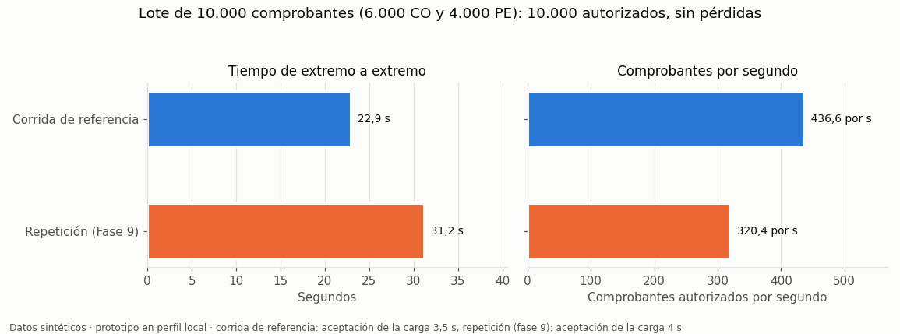

# VeriAgent · prototipo de la arquitectura agéntica verificable para facturación electrónica multipaís

> **Advertencia.** Prototipo académico del Trabajo Fin de Grado (Ingeniería Informática, UNIR). Trabaja solo con
> datos sintéticos, no tiene autenticación real (tokens de demostración generados al arrancar) y no es apto para
> producción. Los hallazgos de seguridad y su estado están en [docs/SEGURIDAD.md](docs/SEGURIDAD.md).

El prototipo es un instrumento de validación técnica de la arquitectura de la Entrega 3: integra comprobantes de
tres países sintéticos (CO, PE y XX) con tres proveedores simulados (Alfa, Beta y Gamma), verifica cada documento
con un kit determinista antes de enviarlo y deja que los agentes de IA propongan mapeos que solo una persona puede
aprobar y activar. Ningún nombre, especificación, catálogo ni comprobante corresponde a una organización real.

## Contenido

- [Arquitectura](#arquitectura)
- [Cómo ejecutarlo](#cómo-ejecutarlo)
- [Resultados principales](#resultados-principales)
- [Gráficos de evaluación](#gráficos-de-evaluación)
- [Modelos de lenguaje: dónde intervienen y qué se entrena](#modelos-de-lenguaje-dónde-intervienen-y-qué-se-entrena)
- [Estructura](#estructura)
- [Documentación](#documentación)

## Arquitectura



Ciclo gobernado de un mapeo (ADR-04 y ADR-05):



## Cómo ejecutarlo

Las instrucciones se validaron el 24 de octubre de 2026 desde un clon limpio del repositorio en una carpeta temporal cuya ruta
tiene espacios (Windows 11, PowerShell 5.1). Cada paso indica si se validó; lo marcado **no validado** no se
ejecutó en esa prueba.

### 1. Requisitos

| Herramienta | Versión | Windows | Linux (Debian o Ubuntu) |
|:---|:---|:---|:---|
| JDK | 21 | `winget install EclipseAdoptium.Temurin.21.JDK` y `JAVA_HOME` apuntando a ese JDK | `sudo apt install openjdk-21-jdk` |
| Maven | 3.9 o superior | `choco install maven`, o el ZIP de maven.apache.org en el `PATH` | `sudo apt install maven` (si la versión es menor que 3.9, el ZIP de maven.apache.org) |
| Python | 3.12 | lo instala `uv` (siguiente fila) | lo instala `uv` |
| uv | reciente (se probó 0.11.7) | `powershell -ExecutionPolicy ByPass -c "irm https://astral.sh/uv/install.ps1 \| iex"` | `curl -LsSf https://astral.sh/uv/install.sh \| sh` |
| Git | cualquiera reciente | `winget install Git.Git` | `sudo apt install git` |

Los comandos de instalación de esta tabla son los oficiales de cada herramienta, pero **no se validaron** en la
prueba, porque la máquina ya las tenía instaladas: JDK 21.0.12 (portable), Maven 3.9.16, uv 0.11.7 y Git; Python 3.12.15 lo aportó uv. Compruébalo con `java -version`, `mvn -v` y `uv --version`.

### 2. Clonar

```powershell
git clone https://github.com/AlejoTechEngineer/veriagent-einvoice-latam.git
cd veriagent-einvoice-latam\prototipo
```

Validado.

### 3. Dependencias de Python (plano agéntico)

```powershell
cd agentic-plane
uv venv --python 3.12                 # descarga Python 3.12 si no está instalado
uv pip install -e ".[test]" packaging
cd ..
```

Validado: 17 s, 70 paquetes. No hace falta ninguna clave de API: sin `ANTHROPIC_API_KEY`, los agentes usan el motor
heurístico (ver [Modelos de lenguaje](#modelos-de-lenguaje-dónde-intervienen-y-qué-se-entrena)).

### 4. Compilar y arrancar la plataforma

```powershell
scripts\run-local.ps1 -Build -Clean -Background
```

Compila con Maven, arranca la plataforma en el perfil local (un proceso Java, bus en memoria y H2 en archivo, sin
Docker) y, en segundo plano, la API de revisión de propuestas en Python. Validado: 79 s hasta «Plataforma lista», compilación incluida.

En Linux no hay `run-local.sh`. El equivalente manual es este (**no validado**; los escenarios son scripts de
PowerShell y en Linux se ejecutan con `pwsh`, también **no validado**):

```bash
mvn -B -q -f integration-plane/pom.xml install -DskipTests
VERIAGENT_HOME="$PWD" java -jar integration-plane/platform-app/target/platform-app-0.1.0.jar --spring.profiles.active=local
```

### 5. Abrir el front y la documentación de la API

| Qué | Dirección | Validado |
|:---|:---|:---|
| Front mínimo | http://127.0.0.1:8080/ | Sí (200) |
| Documentación de la API (Swagger UI) | http://127.0.0.1:8080/swagger-ui.html | Sí (200) |
| Contrato OpenAPI | http://127.0.0.1:8080/v3/api-docs | Sí (200) |
| API de revisión de propuestas (FastAPI) | http://127.0.0.1:8090/docs | Sí (200) |
| Salud | http://127.0.0.1:8080/actuator/health | Sí (200) |

### 6. Tokens de demostración

Al arrancar se generan tokens aleatorios en `results\runtime\demo-tokens.json`, un archivo local que **git ignora**
(se comprobó con `git check-ignore`). Hay uno por identidad: `reviewer-a` y `reviewer-b` (REVIEWER), `agente.mapeo` (AGENT), `operador.demo` (OPERATOR) y `sistema` (SYSTEM). Para entrar al front, copia el token del
rol que quieras probar. Los tokens cambian en cada arranque y no son autenticación real.

### 7. Pruebas automáticas

```powershell
scripts\test-all.ps1          # Maven verify, clases del kit con javac y pytest; -SoloJava o -SoloPython para una parte
```

No necesita la plataforma en marcha ni Docker, pero sí el entorno de Python del paso 3. Antes de pytest compila con
`javac` las clases del kit en `verification-kit\build\classes`, que las pruebas del modo lote necesitan y Maven no
genera; sin ese paso, 4 pruebas de pytest fallan en un clon limpio. Comprueba que el Java en uso sea la versión 21 y
termina con código 1 si alguna parte falla.

Validado el 24 de octubre de 2026 en un clon limpio nuevo: código de salida 0 en 254 s; Maven, 141 pruebas en 32
suites, 0 fallos y 1 omitida (la de Kafka, sin Docker); pytest, 57 de 57 en 32 s.

Los comandos equivalentes, por si se quieren ejecutar a mano:

```powershell
mvn -B -q -f integration-plane/pom.xml verify          # reactor Java (incluye el kit)
javac -d verification-kit\build\classes (Get-ChildItem verification-kit\src\main\java -Recurse -Filter *.java).FullName
cd agentic-plane; .\.venv\Scripts\python.exe -m pytest -q; cd ..
```

Los escenarios de `todos.ps1` no necesitan las clases del kit. Con Git Bash o en Linux, `bash ci/run-pipeline.sh` ejecuta todas las etapas del pipeline
(compilación, pruebas, gates y prueba de humo); **no validado** en esta prueba.

### 8. Demostración y escenarios

```powershell
scripts\demo.ps1 -Build       # -Build la primera vez (compila); -NoAbrir para no abrir el navegador
scripts\stop-local.ps1        # al terminar
```

`demo.ps1` detiene una plataforma anterior, borra el estado local (como `run-local.ps1 -Clean`) y la base de
propuestas de demostración (`results\proposals.db`), y arranca la plataforma con la API de revisión. Después siembra
datos sintéticos: un lote de 50 comprobantes válidos (30 de Colombia y 20 de Perú) por la ingesta, una emisión
síncrona, un comprobante rechazado por el proveedor simulado Alfa que queda en la DLQ y dos propuestas de mapeo del
agente (una bloqueada por el kit y otra pendiente de revisión). Al final muestra los tokens de demostración de los
roles OPERATOR, REVIEWER y AGENT y abre http://127.0.0.1:8080/. La plataforma queda en marcha.

Validado el 24 de octubre de 2026 en un clon limpio nuevo, con `-Build`: código de salida 0 en unos 40 s (se ejecutó
después de `test-all.ps1` en el mismo clon, así que la compilación fue incremental). Se comprobó por la API: 52 comprobantes registrados, 51 autorizados y 1 en la DLQ (rechazo
`PROVIDER_REJECTED`, HTTP 422), balance de conservación correcto, 2 propuestas visibles por la API de borde
(`PENDING_REVIEW` y `BLOCKED_BY_GATE`), y el front (8080) y la API de revisión (8090) respondiendo 200. No se
comprobó a la vista que el navegador abriera la pestaña. Tras las pruebas y la demo, `git status` del clon no
mostró archivos generados.

Para recorrer escenarios concretos con la plataforma en marcha:

```powershell
scripts\escenarios\S1.ps1     # una emisión síncrona de principio a fin
scripts\escenarios\S5.ps1     # el agente propone un mapeo y dos personas lo aprueban y lo activan
```

Para todos los escenarios (S1 a S8, banco de 22, rendimiento, falsos positivos y banco ampliado):

```powershell
scripts\escenarios\todos.ps1   # arranca y detiene la plataforma por sí mismo
```

Validado: código de salida 0 en 428 s (unos 7 minutos); los 12 resultados quedaron aprobados, con el banco ampliado en 121 de 129 en ejecución y 129 de 129 con ejemplos validados, y 0 falsos positivos en 11.402 comprobantes correctos. Los resultados quedan en `results\escenarios\`.

### 9. Perfil full con Docker

El perfil full (Redpanda y PostgreSQL) se levanta con `docker compose up -d --build`, tras copiar `.env.example` a
`.env`. **No validado:** no se ejecutó en la máquina de trabajo porque el daemon de Docker no estaba disponible.
Solo se comprobó la sintaxis con `docker compose config`.

### 10. Problemas frecuentes

| Problema | Síntoma | Solución |
|:---|:---|:---|
| `JAVA_HOME` apunta a otro JDK | Maven o el script usan un Java distinto de 21 y la compilación o el arranque fallan | `run-local.ps1` usa primero `JAVA_HOME` y Maven también. Apúntalo a un JDK 21 (`$env:JAVA_HOME = 'C:\ruta\al\jdk-21'`). Se observó en la prueba: la máquina tenía `JAVA_HOME` en un JDK 17 |
| Ruta con espacios | Rutas cortadas en los argumentos de Java o de Python | Los scripts entrecomillan las rutas; la prueba se hizo en una carpeta con espacios y funcionó. Si algo falla, clona en una ruta sin espacios (por ejemplo `C:\src`) |
| Configuración regional del JDK | Con `es`, el validador XML devuelve mensajes traducidos | El kit clasifica los errores del esquema por su código (`cvc-...`), no por el texto, y su suite se ejecuta con `es` y con `en`. Si un fallo depende del idioma, repite con `-Duser.language=en` para aislarlo |
| Puertos ocupados | `run-local.ps1` no llega a «Plataforma lista» o la API de revisión no arranca | La plataforma usa 8080 y la API de revisión 8090. Busca el proceso con `Get-NetTCPConnection -LocalPort 8080` (Windows) o `ss -ltnp \| grep 8080` (Linux) y detenlo; `scripts\stop-local.ps1` detiene una plataforma anterior |
| Falta el entorno de Python | `No existe ...\agentic-plane\.venv\Scripts\python.exe` | Repite el paso 3 |
| Falta el JAR | `No existe ...platform-app-0.1.0.jar. Ejecuta antes scripts\run-local.ps1 -Build (o scripts\demo.ps1 -Build).` | Arranca con `-Build` (paso 4 o paso 8) |

## Resultados principales

| Evidencia | Resultado | Detalle |
|:---|:---|:---|
| Pruebas | Java: 141, 0 fallos, 1 omitida (Kafka, sin Docker); Python: 57 de 57 (Fase 9) | `docs/BITACORA.md` |
| Escenarios S1 a S8 | 8 de 8 en verde con un comando | `docs/ESCENARIOS.md` |
| Banco original (22, el del documento), por el sistema real | ejecución 86 %, kit + ejemplos validados 100 %, 0 falsos positivos | `results/escenarios/BANCO.json` |
| Banco ampliado (129 mutantes, semilla 2026) | ejecución 93,8 % (IC 95 % 88,2–96,8 %), con ejemplos validados 100 % (97,1–100 %) | `results/escenarios/banco_ampliado.json` |
| Falsos positivos | 0 de 11.402 comprobantes correctos (cota superior 95 %: 0,026 %) | `results/escenarios/falsos_positivos.json` |
| Emisión síncrona | p95 54 ms (umbral del documento: 3 s) | `results/escenarios/RENDIMIENTO.json` |
| Lote | 10.000 comprobantes en 22,9 s, sin pérdidas | ídem |

## Gráficos de evaluación

Los tres gráficos se generan con matplotlib a partir de los resultados guardados en `results/escenarios/`
(corrida de referencia) y `results/escenarios/fase9/` (repetición). Todos usan **datos sintéticos**.



**Detección por tipo de defecto (D1 a D6) y mecanismo**, en el banco original (22 mutantes) y en el ampliado (129),
con el intervalo de Wilson al 95 %. Con los ejemplos validados se detectan todos en ambos bancos. En ejecución
escapan sobre todo D1 (códigos válidos pero intercambiados) y D6. Con 2 a 30 mutantes por tipo los intervalos son
anchos: las tasas por tipo son indicativas y la total del banco ampliado (121 de 129, 88,2–96,8 %) es la más estable.



**Latencias** (p50 y p95, escala logarítmica) de la verificación del kit en proceso y por HTTP, y de la emisión
síncrona completa con el simulador del proveedor, en dos corridas. La p95 de la emisión (54 a 57 ms) queda muy por
debajo del umbral de 3 s.



**Lote de 10.000 comprobantes**: tiempo de extremo a extremo y comprobantes por segundo en las dos corridas
(22,9 s y 31,2 s), con los 10.000 autorizados y sin pérdidas. Es una corrida corta en un solo proceso con
simuladores locales: no sustituye una prueba de carga sostenida.

## Modelos de lenguaje: dónde intervienen y qué se entrena

**El prototipo no entrena ni ajusta ningún modelo.** No contiene redes neuronales ni aprendizaje automático
propio, y no hay curvas de entrenamiento, porque no hay entrenamiento. Las dependencias de Python
(`agentic-plane/pyproject.toml`) son pydantic, lxml, FastAPI, uvicorn, httpx, mcp, anthropic y langgraph, y las de
prueba, pytest e hypothesis. Ni el código ni las dependencias incluyen torch, tensorflow, keras, scikit-learn,
transformers, xgboost u otras librerías de aprendizaje automático. La única librería numérica es NumPy, en
`planning/model.py`, para la simulación de Monte Carlo de la planificación.

Cuando se usa un modelo de lenguaje, es un modelo **preentrenado por su proveedor** (un transformador, es decir,
una red neuronal entrenada fuera de este trabajo) al que el prototipo llama por API. El prototipo solo construye
el prompt con la especificación sintética y el modelo canónico y filtra la respuesta.

| Componente | ¿Usa un modelo? | Detalle |
|:---|:---|:---|
| `mapping-agent` (`tfg_agents/mapping_agent.py`, Perfil Alfa, CO) | Opcional | Motor por defecto `heuristic-v1`: similitud léxica con un glosario mínimo, determinista. Con `ANTHROPIC_API_KEY` usa `anthropic-llm` (modelo en `TFG_LLM_MODEL`), que devuelve JSON y del que se descartan los campos inventados |
| Agente de mapeo por especificación (`tfg_agents/spec_mapping_agent.py`, Gamma, XX, escenario S5) | Opcional | Lee la especificación **vía MCP** (`mcp-spec-reader`). Motor por defecto `spec-heuristic-v1`, determinista; con `ANTHROPIC_API_KEY`, `SpecLlmBackend` |
| `legacy-extraction-agent` (`tfg_agents/legacy_agent.py`) | **No** | Extrae tablas de códigos y saneamientos del código heredado sintético con expresiones regulares y cita archivo y línea. Determinista |
| `dlq-triage-agent` (`tfg_agents/triage_agent.py`) | **No** | Clasifica los fallos de la DLQ a partir de los hallazgos del kit y del proveedor. Determinista; nunca reprocesa |
| Servidores MCP (`spec-reader`, `catalog`, `validator`, `repo`) | **No** | Herramientas deterministas que los agentes consultan |
| Orquestador (`tfg_agents/agent_orchestrator.py`, LangGraph) | No por sí mismo | Encadena proponer, verificar con el kit, abrir la solicitud de cambio y registrar la versión candidata. Elige el motor de cada destino; solo el motor LLM reintenta con los hallazgos |
| **Kit de verificación** (`verification-kit/`, Java) | **Nunca** | Esquema, reglas D1 a D6 y ejemplos validados. Es determinista: la misma entrada da siempre el mismo resultado |

Sin `ANTHROPIC_API_KEY`, todo el prototipo, con sus pruebas y escenarios, funciona con los motores heurísticos.
Las cifras de este README salen de esa configuración. Con la clave, la salida del modelo sigue siendo solo una
propuesta: pasa por el kit y por dos personas, y la lista blanca de salida (`tfg_agents/egress.py`) limita las
conexiones al kit, a la plataforma y al proveedor del modelo.

**Trabajo futuro:** una línea base de aprendizaje automático para el agente de mapeo (por ejemplo, un clasificador
de correspondencias entrenado con mapeos validados) que compare su exactitud por campo con el motor heurístico y
con el LLM, con el mismo kit como verificador.

## Estructura

```
integration-plane/      plano de integración (Maven multimódulo): contratos, núcleo, servicios, simuladores,
                        registro de mapeos, API de borde con el front y la aplicación Boot única (platform-app)
verification-kit/       kit de verificación determinista (Java 21) con reglas D1 a D6 y procedencia
data-generator/         generador de comprobantes sintéticos con semilla
agentic-plane/          agentes, orquestador LangGraph, servidores MCP, API de revisión, escenarios y bancos
specs/ catalogs/ schemas/   normativa sintética (huellas en ci/normativa.sha256)
data/                   numeración, enrutamiento, mapeos, ejemplos validados y legado sintético
scripts/                arranque local, demostración, pruebas y escenarios (PowerShell)
ci/ Jenkinsfile         pipeline y gates
deploy/ docker-compose.yml  imágenes, perfil full y chart de Helm
review-console-web/ review-console-javafx/  consolas de revisión de la prueba de concepto base
planning/               modelo de planificación de la Entrega 3
results/                resultados de escenarios, banco, capturas y evaluación del kit
docs/                   plan, bitácora, trazabilidad, escenarios, desviaciones, supuestos, seguridad, versiones y ADR
```

## Documentación

- [docs/TRAZABILIDAD.md](docs/TRAZABILIDAD.md): requisitos, ADR, escenarios de calidad y componentes frente a
  código, pruebas y evidencia.
- [docs/ESCENARIOS.md](docs/ESCENARIOS.md): S1 a S8, bancos de defectos, falsos positivos y mediciones.
- [docs/DESVIACIONES.md](docs/DESVIACIONES.md) y [docs/SUPUESTOS.md](docs/SUPUESTOS.md): diferencias con la
  Entrega 3 y decisiones ante ambigüedades.
- [docs/BITACORA.md](docs/BITACORA.md): cada fase con los comandos y los resultados reales.
- [docs/SEGURIDAD.md](docs/SEGURIDAD.md), [docs/VERSIONES.md](docs/VERSIONES.md), [docs/PLAN.md](docs/PLAN.md)
  y [docs/adr/](docs/adr/).
