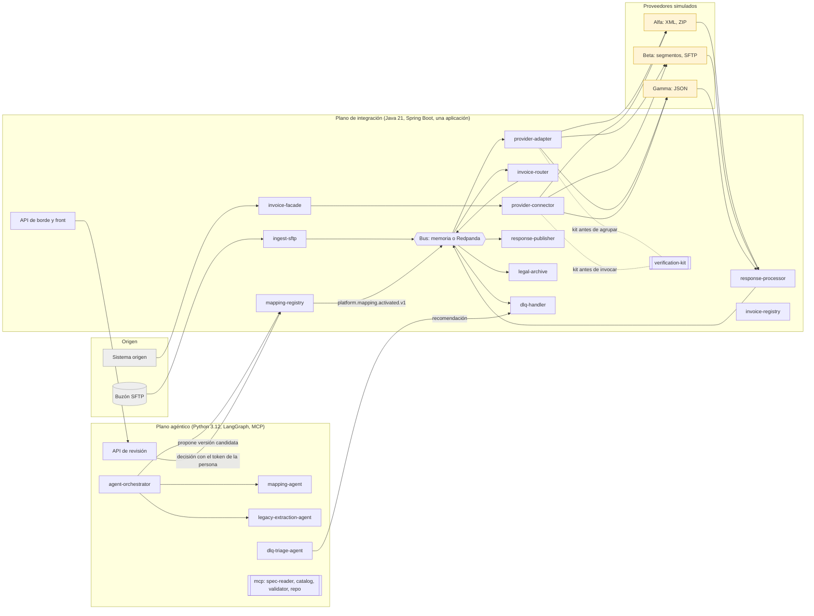
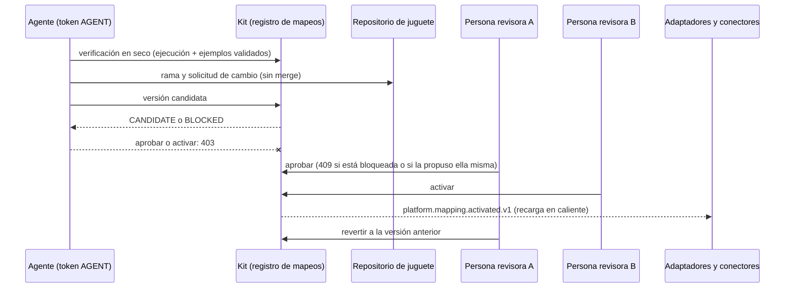

# VeriAgent · prototipo de la arquitectura agéntica verificable para facturación electrónica multipaís

> **Advertencia.** Prototipo académico del Trabajo Fin de Grado (Ingeniería Informática, UNIR). Trabaja solo con
> datos sintéticos, no tiene autenticación real (tokens de demostración generados al arrancar) y no es apto para
> producción. Los hallazgos de seguridad y su estado están en [docs/SEGURIDAD.md](docs/SEGURIDAD.md).

El prototipo es un instrumento de validación técnica de la arquitectura de la Entrega 3: integra comprobantes de
tres países sintéticos (CO, PE y XX) con tres proveedores simulados (Alfa, Beta y Gamma), verifica cada documento
con un kit determinista antes de enviarlo y deja que los agentes de IA propongan mapeos que solo una persona puede
aprobar y activar. Ningún nombre, especificación, catálogo ni comprobante corresponde a una organización real.

## Arquitectura



Ciclo gobernado de un mapeo (ADR-04 y ADR-05):



## Inicio rápido (Windows, sin Docker)

Requisitos: JDK 21, Maven 3.9, Python 3.12 con `uv` y PowerShell 5.1 o superior.

```powershell
cd prototipo\agentic-plane; uv venv --python 3.12; uv pip install -e ".[test]" packaging; cd ..
scripts\run-local.ps1 -Build -Clean -Background   # plataforma en 127.0.0.1:8080 y API de revisión en 127.0.0.1:8090
start http://127.0.0.1:8080                       # front; los tokens están en results\runtime\demo-tokens.json
scripts\escenarios\todos.ps1                      # S1 a S8, banco de 22, rendimiento, falsos positivos y banco ampliado
scripts\stop-local.ps1
```

`scripts\escenarios\todos.ps1` arranca y detiene la plataforma por sí mismo. Cada escenario tiene su script
(`S1.ps1` a `S8.ps1`, `banco.ps1`, `rendimiento.ps1`, `falsos_positivos.ps1`, `banco_ampliado.ps1`) y deja su
resultado en `results/escenarios/`. El pipeline completo corre en local con `bash ci/run-pipeline.sh` (Linux o
Git Bash). El perfil full (Redpanda y PostgreSQL) se levanta con `docker compose up -d --build` tras copiar
`.env.example` a `.env`; no se ejecutó en la máquina de trabajo (sin Docker).

## Resultados principales

| Evidencia | Resultado | Detalle |
|:---|:---|:---|
| Pruebas | Java: 138, 0 fallos, 1 omitida (Kafka, sin Docker); Python: 42 de 42 | `docs/BITACORA.md` |
| Escenarios S1 a S8 | 8 de 8 en verde con un comando | `docs/ESCENARIOS.md` |
| Banco original (22, el del documento), por el sistema real | ejecución 86 %, kit + ejemplos validados 100 %, 0 falsos positivos | `results/escenarios/BANCO.json` |
| Banco ampliado (129 mutantes, semilla 2026) | ejecución 93,8 % (IC 95 % 88,2–96,8 %), con ejemplos validados 100 % (97,1–100 %) | `results/escenarios/banco_ampliado.json` |
| Falsos positivos | 0 de 11.402 comprobantes correctos (cota superior 95 %: 0,026 %) | `results/escenarios/falsos_positivos.json` |
| Emisión síncrona | p95 54 ms (umbral del documento: 3 s) | `results/escenarios/RENDIMIENTO.json` |
| Lote | 10.000 comprobantes en 22,9 s, sin pérdidas | ídem |

## Estructura

```
integration-plane/      plano de integración (Maven multimódulo): contratos, núcleo, servicios, simuladores,
                        registro de mapeos, API de borde con el front y la aplicación Boot única (platform-app)
verification-kit/       kit de verificación determinista (Java 21) con reglas D1 a D6 y procedencia
data-generator/         generador de comprobantes sintéticos con semilla
agentic-plane/          agentes, orquestador LangGraph, servidores MCP, API de revisión, escenarios y bancos
specs/ catalogs/ schemas/   normativa sintética (huellas en ci/normativa.sha256)
data/                   numeración, enrutamiento, mapeos, ejemplos validados y legado sintético
scripts/                arranque local y escenarios (PowerShell)
ci/ Jenkinsfile         pipeline y gates
deploy/ docker-compose.yml  imágenes, perfil full y chart de Helm
review-console-web/ review-console-javafx/  consolas de revisión de la prueba de concepto base
planning/               modelo de planificación de la Entrega 3
results/                resultados de escenarios, banco, capturas y evaluación del kit
docs/                   plan, bitácora, trazabilidad, escenarios, desviaciones, supuestos, seguridad, versiones y ADR
```

## Documentación

- [docs/TRAZABILIDAD.md](docs/TRAZABILIDAD.md): requisitos, ADR, escenarios de calidad y componentes frente a
  código, pruebas y evidencia.
- [docs/ESCENARIOS.md](docs/ESCENARIOS.md): S1 a S8, bancos de defectos, falsos positivos y mediciones.
- [docs/DESVIACIONES.md](docs/DESVIACIONES.md) y [docs/SUPUESTOS.md](docs/SUPUESTOS.md): diferencias con la
  Entrega 3 y decisiones ante ambigüedades.
- [docs/BITACORA.md](docs/BITACORA.md): cada fase con los comandos y los resultados reales.
- [docs/SEGURIDAD.md](docs/SEGURIDAD.md), [docs/VERSIONES.md](docs/VERSIONES.md), [docs/PLAN.md](docs/PLAN.md)
  y [docs/adr/](docs/adr/).
