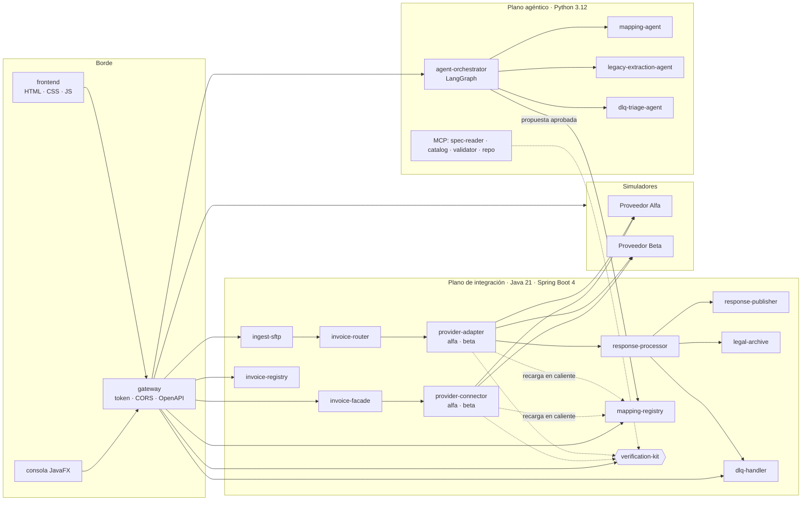

# Plan del prototipo

Prototipo completo de la arquitectura agéntica verificable descrita en la Entrega 3 del TFG
(documento `TFG_Entrega3_DeMendozaTovar.docx`, que actúa como especificación). Todo el contenido es
sintético: proveedores ficticios **Alfa** y **Beta**, países **CO** y **PE** (los del documento) y un país
sintético **XX**.

El plan parte de la prueba de concepto previa (`tfg-poc-base`), que se conserva y se extiende:
el kit de verificación, el plano agéntico, las consolas, la especificación sintética, los catálogos, el XSD,
la planificación, CI y despliegue.

## 1. Estructura de carpetas

```
prototipo/
  README.md                    Guía del prototipo (se reescribe en la Fase 8)
  .gitignore                   Exclusiones del prototipo
  .env.example                 Variables de entorno de ejemplo (sin secretos)
  docs/                        PLAN, BITACORA, SUPUESTOS, DESVIACIONES, VERSIONES, TRAZABILIDAD, ESCENARIOS
    adr/                       Las diez ADR (heredadas de la base)
  scripts/                     run-local.ps1, test-all.ps1, demo.ps1, scenario.ps1 y equivalentes .sh
  specs/                       Especificaciones sintéticas (Perfil Alfa v2.1, formato Beta, país XX)
  catalogs/                    Catálogos versionados (heredados y ampliados por país)
  schemas/                     XSD del perfil Alfa (heredado)
  planning/                    EDT, supuestos y modelo PERT/Monte Carlo (heredado, sin cambios)
  ci/                          run-pipeline.sh y Jenkins como código (heredado y actualizado en la Fase 7)
  deploy/                      Dockerfiles y chart de Helm (heredado y ampliado en la Fase 7)
  verification-kit/            Kit de verificación Java 21 sin dependencias (heredado; se corrige y se
                               publica también como artefacto Maven para el plano de integración)
  integration-plane/           NUEVO. Maven multimódulo, Java 21, Spring Boot 4
    pom.xml                    Padre y BOM (Spring Boot, Camel, springdoc)
    platform-contracts/        Modelo canónico, JSON Schema de eventos versionados, nombres de topics
    platform-core/             Bus de eventos (memoria y Kafka), persistencia, idempotencia, correlación,
                               máquina de estados, reintentos, auditoría, motor de mapeo
    kit-adapter/               Integración del verification-kit como biblioteca y API HTTP /api/kit
    svc-ingest-sftp/           Biblioteca de cada servicio (lógica, API REST y configuración)
    svc-invoice-facade/
    svc-invoice-router/
    svc-provider-adapter/      Adaptador por lotes con dos estrategias: alfa y beta
    svc-provider-connector/    Conector síncrono con dos estrategias: alfa y beta
    svc-response-processor/
    svc-response-publisher/
    svc-legal-archive/
    svc-invoice-registry/
    svc-dlq-handler/
    svc-mapping-registry/      Registro de versiones de mapeo (activar, recargar en caliente, revertir)
    platform-app/              Aplicación Spring Boot delgada: habilita los servicios por propiedad
  provider-simulators/         NUEVO. Simuladores Alfa y Beta (Spring Boot), fallos inyectables
  data-generator/              NUEVO. Generador reproducible de comprobantes y lotes (Java, con semilla)
  gateway/                     NUEVO. API de borde (BFF): token de demostración, CORS, OpenAPI agregado
  frontend/                    NUEVO. Front web: HTML, CSS y JavaScript (módulos ES), sin compilación
  agentic-plane/               Plano agéntico Python 3.12 (heredado y extendido): LangGraph, agentes,
                               servidores MCP y API de propuestas
  review-console-web/          Consola web de revisión (heredada)
  review-console-javafx/       Consola de escritorio JavaFX (heredada; se apunta a la nueva API)
  data/
    sandbox-repo/              Repositorio de juguete donde el servidor MCP repo crea ramas simuladas
    numeracion/                Configuración de numeración por país (CSV)
  results/                     Evidencias de la base y resultados de los escenarios (runtime/ se ignora)
```

Cada servicio separa la **biblioteca** (lógica, API y autoconfiguración) de la **aplicación Boot**, que es
una sola y delgada (`platform-app`). La propiedad `veriagent.services` decide qué servicios se cargan:

- **Perfil `local`**: un proceso Java con todos los servicios, los simuladores y el gateway. Bus de eventos en
  memoria y H2 en archivo. El plano agéntico es un segundo proceso (Python); `scripts/run-local.ps1` arranca
  ambos con un solo comando.
- **Perfil `full`**: la misma imagen se ejecuta varias veces en `docker compose`, cada contenedor con un
  subconjunto de servicios, más Redpanda (compatible con Kafka) y PostgreSQL. La misma lógica y las mismas
  pruebas corren en ambos perfiles.

## 2. Diagrama de módulos



## 3. Flujos

**Síncrono**: `POST /api/invoices` en la fachada → registro `RECEIVED` → conector del proveedor (mapeo
vigente + kit en modo ejecución) → simulador → `AUTHORIZED` o `FAILED` en la misma llamada.

**Asíncrono por lotes**: archivo depositado en la carpeta SFTP simulada → `ingest-sftp` (descompresión acotada
y validación del canónico con JSON Schema) → `{pais}.invoice.request.v1` → `invoice-router` →
`{pais}.{proveedor}.request.v1` → `provider-adapter` (mapeo + kit antes de agrupar) → `PENDING_BATCH` → envío
del lote → `SENT` → respuesta diferida → `response-processor` → `{pais}.invoice.response.v1` →
`response-publisher`, `legal-archive` y, ante fallo no recuperable, `{pais}.invoice.dlq.v1` → `dlq-handler`.

**Ciclo gobernado** (ADR-04 y ADR-05): el agente propone un mapeo → el kit lo verifica (muestra en ejecución y
fixtures en CI) → si no pasa queda `BLOCKED_BY_GATE` y aprobarlo devuelve 409 → si pasa, una persona aprueba →
el mapeo se publica como versión nueva en `mapping-registry` → adaptadores y conectores la recargan en caliente
→ existe reversión a la versión anterior. Toda decisión queda en `authorization_log` con revisor y fecha.

**Invariante de conservación**: en cada escenario, comprobantes de entrada = salidas (autorizados + rechazados
por el proveedor + bloqueados por el kit) + DLQ.

## 4. Puertos

| Componente | Perfil `local` | Perfil `full` |
|:---|:---:|:---:|
| gateway + frontend (y, en local, todos los servicios) | 8080 | 8080 |
| invoice-facade | — | 8081 |
| ingest-sftp | — | 8082 |
| invoice-router | — | 8083 |
| provider-adapter (alfa y beta) | — | 8084 |
| verification-kit (HTTP del kit, como en la base) | 8085 | 8085 |
| provider-connector (alfa y beta) | — | 8086 |
| response-processor | — | 8087 |
| response-publisher | — | 8088 |
| legal-archive | — | 8089 |
| plano agéntico (API de propuestas y orquestador, como en la base) | 8090 | 8090 |
| invoice-registry | — | 8091 |
| dlq-handler | — | 8092 |
| mapping-registry | — | 8093 |
| simulador Alfa | — | 8095 |
| simulador Beta | — | 8096 |
| Redpanda (Kafka) | — | 9092 |
| PostgreSQL | — | 5432 |

En el perfil `local` todo el plano de integración, los simuladores y el gateway comparten el puerto 8080 bajo
rutas distintas (`/api/...`, `/sim/alfa/...`, `/sim/beta/...`); el kit también se expone en 8085, como en la base.

## 5. Topics y eventos

Convención del documento (apartado 4.4.4 y tabla 11): `{pais}.invoice.{request|response|dlq}.v{n}` y
`{pais}.{proveedor}.{request|response}.v{n}`, en minúsculas, particionados por número de comprobante.

| Topic | Productor | Consumidor | Esquema (JSON Schema) |
|:---|:---|:---|:---|
| `co.invoice.request.v1`, `pe.invoice.request.v1`, `xx.invoice.request.v1` | ingest-sftp | invoice-router | `invoice-request.v1.json` |
| `{pais}.alfa.request.v1`, `{pais}.beta.request.v1` | invoice-router | provider-adapter | `provider-request.v1.json` |
| `{pais}.alfa.response.v1`, `{pais}.beta.response.v1` | provider-adapter (respuesta diferida) | response-processor | `provider-response.v1.json` |
| `{pais}.invoice.response.v1` | response-processor, invoice-facade | response-publisher, legal-archive, invoice-registry | `invoice-response.v1.json` |
| `{pais}.invoice.dlq.v1` | adaptadores, response-processor | dlq-handler | `invoice-dlq.v1.json` |
| `platform.mapping.activated.v1` | mapping-registry | adaptadores y conectores | `mapping-activated.v1.json` |

El último topic no figura en el documento: se añade para la recarga en caliente y se registra en
`DESVIACIONES.md`. Todos los eventos llevan `eventId`, `correlationId`, `invoiceKey` (clave de idempotencia),
`country`, `occurredAt` y `schemaVersion`.

## 6. Datos

Tablas del núcleo (apartado 4.4.5): `authorization_log` (estado y auditoría de cada comprobante),
`rule_provenance` (regla → sección y huella de la norma) y `agent_proposal` (auditoría de la IA). Se añaden
`invoice_state_history`, `idempotency_key`, `dlq_entry`, `legal_archive_entry` (cadena de huellas SHA-256) y
`mapping_version`. Migraciones con Flyway, iguales para H2 (local) y PostgreSQL (full).

## 7. Versiones elegidas

| Pieza | Documento | Elegida | Nota |
|:---|:---|:---|:---|
| Java | 21 (LTS) | Temurin 21.0.12 (portable en `%USERPROFILE%\tools`) | La máquina solo tenía JDK 17 |
| Maven | — | 3.9.16 | Instalado |
| Spring Boot | 4 | 4.1.1 | Última estable |
| Apache Camel | 4 | 4.23.0 | Alineada con Spring Boot 4.1.1 |
| springdoc-openapi | — | 3.1.1 | Línea compatible con Spring Boot 4 |
| Kafka | Kafka con Schema Registry | Redpanda v26.2.5 (perfil full); bus en memoria (local) | Esquemas como JSON Schema versionado en el código |
| Base de datos | SQL Server + PostgreSQL/pgvector | H2 2.x (local) y PostgreSQL 18 (full) | Ver DESVIACIONES |
| Flyway | Sí | La que gestiona Spring Boot 4.1.1 | |
| Resiliencia | Resilience4j | Se decide en la Fase 1 según compatibilidad con Spring Boot 4 | Se registrará en VERSIONES |
| Pruebas Java | JUnit 5 | JUnit Jupiter de Spring Boot 4.1.1; el kit sigue con JUnit 5 (1.11.4) | |
| Python | 3.12 | 3.12.15 (portable, vía uv) | La máquina tenía 3.14 y 3.13 |
| LangGraph | Sí | 1.2.16 | |
| SDK de MCP | 2.x | 2.3.0 | |
| FastAPI / Pydantic / lxml | Sí | 0.148.0 / 2.14.1 / 6.1.3 | |
| SDK de Anthropic | Sí | 1.15.0 | Solo con `ANTHROPIC_API_KEY` |
| JavaFX | Sí | OpenJFX 21.0.6 | Para la consola de escritorio |
| Front | HTML y CSS puro, JavaScript | Igual, con módulos ES y sin dependencias | |

## 8. Fases

| Fase | Contenido | Cierre |
|:---:|:---|:---|
| 0 | Entorno, copia de la base, pruebas existentes, `.gitignore` y este plan | Commit local; push tras aprobación |
| 1 | Núcleo compartido: canónico, esquemas, bus, persistencia, idempotencia, correlación, contratos y kit como biblioteca | Pruebas, bitácora, push |
| 2 | Servicios del plano de integración con API y pruebas unitarias y de componente | Ídem |
| 3 | Simuladores, generador de datos y registro de mapeos | Ídem |
| 4 | Plano agéntico integrado y ciclo cerrado (proponer, verificar, revisar, activar, revertir) | Ídem |
| 5 | Gateway y front | Ídem |
| 6 | Escenarios S1 a S8, banco de 22 defectos por el sistema real, latencia y rendimiento | Ídem |
| 7 | CI/CD y despliegue (Jenkinsfile, run-pipeline.sh, compose full, Helm) | Ídem |
| 8 | Documentación y trazabilidad; propuesta de bloque para el README de la raíz | Ídem |

## 9. Decisiones del autor (2026-10-19)

- **Formatos (S-01, aceptada).** Alfa: XML del Perfil Alfa v2.1 (basado en UBL 2.1), con un sobre JSON en su
  API REST y lotes por archivo. Beta: texto por segmentos, con lotes en su carpeta SFTP simulada y REST síncrono.
- **Proveedor Gamma (S-07).** Tercer proveedor sintético con formato JSON, asociado al país sintético XX y con su
  propia especificación sintética; se usa en el escenario S5.
- **Seguridad (S-08).** Denegar por defecto, roles `REVIEWER`, `AGENT`, `OPERATOR` y `SYSTEM`, identidad tomada
  siempre del token y tokens de demostración aleatorios generados al arrancar. El modelo de roles y la validación
  de tokens van en `platform-core` (Fase 1). Ver `SEGURIDAD.md`.
- **Docker (S-09).** Si el daemon no inicia, el perfil `full` queda configurado y documentado como "no ejecutado".
- **Pausa** al cerrar la Fase 3, tras ejecutar S1 y S2 de extremo a extremo.
